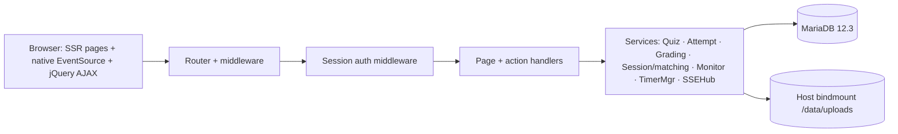

# Repository Guidelines

## Project Overview

quiz-v2 is a **responsive-web, single-school daily-quiz system** (`Mode: A — Greenfield / From Scratch`). Teachers author mixed-type quizzes, run async or synchronous "matching" sessions with timers and focus-loss anti-cheat detection, monitor live, grade essays, and recap scores without spreadsheets.

**This repository is currently pre-implementation**: there is NO `go.mod`, NO source code, NO tests. Everything present is specification — 21 files under `docs/spec/` plus four reference docs (`DESIGN.md`, `GO-FIBER-DOCS.md`, `JQUERY-DOCS.md`, `BOOTSTRAP-V6-DOCS.md`) — plus vendored frontend assets under `assets/`. All rules below are extracted from `docs/spec/` and are **normative** — implementing against them is the task.

- Stack: **Go monolith · Fiber · SSR · MariaDB 12.3.x · Docker Compose · realtime SSE + POST** (DEC-020/118)
- Capacity envelope: ≤500 users total, ≤100 concurrent SSE streams, ≤10 parallel timed sessions; SSE push fan-out budget <2 s (DEC-023)
- Product language: **Bahasa Indonesia UI strings**; spec artifacts stay in English (C4). Preserve Indonesian domain terms (`guru` = teacher, `murid` = student)
- Status: **DRAFT** — all 21 files under `docs/spec/` carry a `Status: DRAFT | Updated:` header. Update the `Updated` note when you modify a spec file

## Architecture & Data Flow

Single-process monolith. The browser is **untrusted**; time, order, correctness, visibility and scoring are re-derived server-side every request.



Request lifecycle (verbatim from `01-ARCHITECTURE-OVERVIEW.md` §3):
`GET/POST + cookie` → `request id` → `load session` → `CSRF check (POST)` → `handler with actor` → `validated DTO` → `service` → `transaction (state check + write)` → `append SSE event if state changed` → `303 redirect | HTML partial | SSE frame`.

Named services and their owners:

| Component | Responsibility |
|---|---|
| Quiz Service | quiz/question CRUD, visibility predicate, freeze guard (BR-006) |
| Attempt Service | register/start/answer/review/submit, shuffle snapshot, idempotency keys |
| Grading Service | objective + essay grading, totals — always in the submit transaction |
| Session Service (matching) | waiting-room set, start/pause/stop/finish state machine, event fan-out |
| Monitor Service | teacher monitor rows; never leaks other students' answers |
| Timer Manager | one goroutine per active timed attempt/session; excludes `paused` from sweeps |
| SSE Hub | per-quiz channels, 30 s heartbeat, no replay buffer, no auto-reconnect |

**Trust boundary decisions:** no ORM (`database/sql` + boring SQL), no cache tier, no distributed queue (a bounded in-process worker pool: 2 workers / queue 100 / 10-min item timeout), no JWT (cookies + DB-backed sessions), single process (prefork explicitly rejected — it would break the in-memory SSE hub/timers).

### Cross-cutting contracts

- **Middleware chain** (exact ordering is not specified; the component set is): request IDs → structured logging → session load → CSRF check on POST → panic recovery → template engine (`c.Render`) → compression. Global CSRF accepts a hidden `csrf_token` form field or the `X-CSRF-Token` header. Only the **cheat beacon** is CSRF-exempt (DEC-108).
- **Error shape (three variants, precedence in DEC-122):** `X-Requested-With` + list endpoint → HTML fragment; explicit `Accept: application/json` on non-list → `{code, message, details, request_id}` snake_case; page form POST → `422` re-rendered HTML with values preserved. Internal diagnostics never reach the client.
- **Logging:** structured JSON to **stdout only**, one `slog`-style line per request with `request_id`/`X-Request-ID`. Never log passwords, hashes, session ids, CSRF tokens, or essay full-text. Persistent data (attempts, grades, `audit_log`) lives in the DB, not log files (DEC-070).
- **Time:** all timestamps UTC ISO-8601 with millis; DB stores `DATETIME(3)` UTC. `submitted_wib` is the sole display exception (`+07:00`, `YYYY-MM-DD HH:MM:SS WIB`).
- **Response caching (ARCH-008, owned entirely by Fiber — no second component):** Class A `/static/…` → `public, max-age=86400`; Class B `/uploads/:ref` → `private, max-age=86400, must-revalidate` + `ETag`/`Last-Modified`/`304`; Class C (all SSR HTML, SSE, `/metrics`, `/healthz`, `/readyz`, XLSX, every POST, every error response) → `no-store`. Domain-wide "Cache Everything" is prohibited.
- **Observability:** log fields are `{ts, level, request_id, actor_id?, role?, route, method, status, latency_ms, quiz_id?, attempt_id?, msg, err_code?}`; levels DEBUG (dev only) / INFO (4xx included) / WARN (auth failures) / ERROR (5xx, txn failures). `GET /metrics` exposes 13 named counters/histograms and is bound to the internal network only. **No distributed tracing and no SLO percentages exist** — correlation is `X-Request-ID` alone, and every alert threshold is an operator decision (DEC-071).

## Key Directories

| Path | Purpose |
|---|---|
| `docs/spec/00-INDEX.md` | **Start here.** Master index, canonical tree, ID conventions, DEC-001..130 decision register, traceability matrix, audit findings F-01..F-72 |
| `docs/spec/01-BUSINESS/` | PRD (REQ-001..010), feature flows (FLOW-001..009), business rules (BR-001..055), state machines (STATE-001..007) |
| `docs/spec/02-ARCHITECTURE-AND-TECHNICAL/` | architecture overview (ARCH-001..009), transport contracts (API-000..070), ERD/schema (R2), RBAC matrix |
| `docs/spec/03-RESILIENCE-AND-ERRORS/` | error matrix (ERR-001..502), fallback strategy (F-001..007), edge cases (EDGE-001..073) |
| `docs/spec/04-FRONTEND-UIUX/` | design system (UI-001..009 — the sole token authority), component states (C-001..C-010), route inventory + navigation graph |
| `docs/spec/05-DEVOPS-AND-INFRA/` | Compose topology, CI/CD pipeline + gates, logging/security/observability |
| `docs/spec/06-QA-AND-MANAGEMENT/` | verification matrix (AC-101..239), backlog (EPIC-1..8 / US-###), before-after delta |
| `assets/jquery-4.0.0/` | jQuery 4.0.0 full build, OBSERVED 78,749 B — vendored into the image at `/static/jquery/` |
| `assets/bootstrap-6.0.0-alpha/` | Bootstrap 6.0.0-alpha CSS + JS — vendored at `/static/bootstrap/` |
| `assets/gotham-rounded/` | Gotham Rounded `.otf` fonts — vendored at `/static/fonts/gotham-rounded/` |
| `docs/GO-FIBER-DOCS.md`, `docs/JQUERY-DOCS.md`, `docs/BOOTSTRAP-V6-DOCS.md` | URL catalogs of upstream documentation; reference only |
| `docs/DESIGN.md` | **NON-authoritative** design inspiration (see UI-009) |

**When application code is created, the spec names only these paths:** `migrations/0001_init.sql`, `seed.sql`, `testdata/` (fixtures only), `go.mod`. No `cmd/`+`internal/`+`handlers/`+`services/` tree is prescribed — layering is a request flow, not package boundaries. Inventing a dogmatic package layout is not mandated; keep the single-process component names above discoverable.

## Development Commands

No build system exists yet. These are the spec-mandated CI gates (CICD-SPEC §1) to target from the first commit:

```bash
gofmt -l .                              # Lint stage — must output nothing
go vet ./...
staticcheck ./...
go test ./... -race                     # Test stage — race failure blocks merge
go test ./... -coverprofile=cover.out   # gates: >=85% overall AND 100% on critical paths
govulncheck ./...
go list -m all                          # dependency audit (Security stage)
<binary> migrate --dry                  # against ephemeral MariaDB 12.3.x; DROP fails unless allow-listed
```

Coverage measurement flags/Makefile/CI YAML are **not specified** — pin the exact `-coverprofile`/threshold invocation when wiring the pipeline.

**Critical paths requiring 100% coverage (DEC-001, no waiver path — S6c):** grading (BR-020/022), timer enforcement (BR-011/012/013, FLOW-009), submit idempotency (F-006, API-038), auth/session (BR-050/053/054, API-001), authorization (RBAC R1–R5), matching control verbs (API-043, STATE-002). Gate AC list is fixed: AC-101/109/110/112/115/123/134/154/156/203/208/210.

**Runtime/deploy:** single Docker image (Go binary + templates + vendored assets, **no build step**), MariaDB 12.3.x container, host bindmount `data/` → `data/uploads` + `data/db`. NGINX was **removed** (ARCH-009) — the app container is exposed directly through Cloudflare; TLS terminates there. Dev bypasses the edge and serves HTTP on a loopback-bound port.

**Health endpoints:** `/healthz` = liveness only (Docker healthcheck). `/readyz` = migrated + DB ping + volume writable — this is the deploy/proxy/CI smoke gate. `/metrics` is internal-interface-bound and never published.

**Frontend conformance is grep-based, not framework-based** (AC-217, fails the build):
```bash
grep -r '<style' templates/                                    # at most one, @font-face only
grep -r '\.css' templates/                                     # only the 2 vendored Bootstrap files
grep -rho '<script[^>]*src="[^"]*"' templates/ | sort -u       # only bootstrap.bundle.min.js + jquery-4.0.0.min.js
```

## Code Conventions & Common Patterns

### ID conventions (from `00-INDEX.md` §3)

`REQ-###` · `BR-###` · `FLOW-###` · `STATE-###` · `API-###` · `ERR-###` · `EDGE-###` · `AC-###` · `DEC-###` · `RISK-###` · `ARCH-###`/`F-###`/`C-###`/`US-###`/`CHG-###` (local to their docs).

> **Letter suffixes are part of the ID** (user decision N-C5, 2026-10-14): `API-039b`, `API-040b`, `API-03A`, `AC-126A`, `AC-134B`, `AC-155C` and `Q1..Q12` are sanctioned. A suffix must **never** be parsed off, normalised away, or treated as a typo.

### Backend

- **No ORM, no cache, no queue.** `database/sql` with an explicit MariaDB/MySQL driver. Module + version pinned in `go.mod` at build time.
- **No foreign keys, no ENUMs, two UNIQUEs, no CHECK constraints, no triggers/views/procedures** (schema revision R2). All integrity is app-enforced in server transactions.
- **State/type/mode values are `TINYINT UNSIGNED` codes, never ENUM.** The word↔code mapping is canonical in `03-ERD-DATA-SCHEMA.md` §1. Transport keeps human words (`normal`, `answering`, `matching`); map at the service boundary. **Unknown codes from a newer binary MUST be rejected fail-closed, never defaulted.**
- **Code table (memorise):** `users.role` 1=teacher 2=student · `users.status` 1=active 2=inactive · `quizzes.quiz_type` 1=normal 2=matching · `quizzes.status` 1=draft 2=open 3=closed · `quizzes.timer_mode` 0=none 1=per_question 2=total · `quizzes.session_state` 1=waiting 2=running 3=paused 4=stopped 5=finished · `attempts.state` 0=registered 1=answering 2=submitted 3=cancelled 4=revoked · `questions.qtype` 1=single 2=multiple 3=essay · `questions.image_status` 0=none 1=processing 2=ready 3=failed.
- **Naming:** snake_case everywhere in JSON transport, SQL columns, and log fields. `snake_case` field names mirror DB columns; transport aliases (`type`→`quiz_type`, `quiz_id`→`id`, `shuffle_questions`→`shuffle_q`) map at the boundary only.
- **Concurrency:** `REPEATABLE READ`, `SELECT ... FOR UPDATE` on hot rows, optimistic `session_version` (409 ERR-300 on mismatch), server-generated `Idempotency-Key` (24 h window), in-Go JSON dedupe under row lock, in-memory 10 s control-verb guard.
- **Server is the time authority.** Never trust a client clock, index, order, or score.
- **Allow-list serialization.** `answer_key_json` must NEVER reach a client/monitor payload (AC-122). A generic `SELECT *`→JSON path is banned by spec.
- **Grading is deterministic (BR-020/022/023):** objective grading is all-or-nothing — single-choice 1 iff `selected == correct`; multiple-choice 1 iff the selected set equals the correct set **exactly** (order-insensitive), else 0 including empty and partial. `final = objective_sum + Σ(essay_grade / 10.0)` rounded half-up to 2 decimals; `temporary = objective_sum` (essays count 0) until all essays are graded. `final_score` is recomputed on every essay grade write. No negative marking — unanswered, auto-locked, and rejected-late answers all grade 0.
- **Attempt lifecycle (STATE-001):** `registered → answering → submitted`, all **same-row** transitions on the `attempts` table (there is no separate registration table). A back-button POST against a `submitted` attempt is rejected with ERR-204; re-entering `answering` after the total deadline is rejected with ERR-206. Crash mid-submit resolves to a single submission via the idempotency key.
- **Matching session lifecycle (STATE-002):** exactly five states — `waiting`, `running`, `paused`, `stopped`, `finished`. Valid exits from `waiting` are only `→ running` (requires ≥1 ever-present occupant, else 422 ERR-113) and `→ finished` (empty-room abort). `finish` is valid **only** from `stopped`; `running`/`paused → finished` is a 409 ERR-300 error, not an implicit stop-then-finish. `stopped` never resumes. `finished` is permanent (DEC-127) — a new run needs a new quiz.
- **`waiting leave` is an occupant-level transition, not a session state** (DEC-121): pre-start `POST /matching/:id/leave` sets `connected=0` but keeps `last_seen` (the row is still ever-present). Once `running`, leave is **rejected** — it is not a 200 echo. The DEC-126 "never an error" echo rule applies only while the session is `waiting`.
- **Config:** env-only (`APP_ENV`, `APP_BASE_URL`, `SESSION_SECRET` 32B+, `DB_HOST`/`DB_PORT`/`DB_*`, `SEED_TEACHER_EMAIL`/`SEED_TEACHER_PASSWORD`, `UPLOAD_DIR`). Secrets in a `0600` host env file, never committed, never logged. `DB_HOST` is the Compose service name; `DB_PORT` is 3306 and is never published.
- **Boot:** `migrate up` → seed → serve. Seed creates exactly one teacher from env iff none exists (`must_change_password=1`); a seed-email collision aborts boot loudly. Abort boot on migration failure.
- **Graceful shutdown** on SIGTERM drains HTTP, SSE streams, timer goroutines, and the 2-worker image pool.

### Frontend

- **Bootstrap 6.0 full + jQuery 4.0.0 full carrier, both on every page** (Bootstrap first, then jQuery). **Native-only exceptions:** SSE (`EventSource`), `sendBeacon` (cheat beacon), and any SPA/router work.
- **Inline CSS only. No custom stylesheet, no Sass, no theme file, no class definitions, no `!important`, no selector override of Bootstrap.** Exactly one `<style>` element per page is permitted and it MUST contain only `@font-face` declarations for Gotham Rounded.
- **Inline property closed list** (anything else is an AC-217 failure): `padding-bottom` (safe-area only), `width` (progress/countdown bars from server data), `position` + `z-index` (frozen name column), `cursor`, `overflow`, `print-color-adjust`, `aspect-ratio`/`object-fit` (question images), `white-space` (chips), `color`/`background-color`/`border-color` (**UI-007 hex only**), `font-family` (Gotham stack), `font-size`/`line-height` (§3A), `border-radius` (15/11/11 px), `box-shadow` (menus/dialogs, sparingly).
- **Server-rendered truth:** HTML must be complete without JS. JS only enhances. The no-JS banner (`alert-warning`) states exactly what is unavailable: cheat detection, SSE push, toasts (DEC-128).
- **jQuery idioms:** `$.ajax`/`$.post`/`$.getJSON` for actions (never raw fetch), `X-Requested-With: XMLHttpRequest` to request HTML fragments, `jqXHR.abort()` on each keystroke, 300 ms search debounce, `history.replaceState` **only** (pushes no history entry), one global `$(document).ajaxComplete(...)` in the page shell to refresh the rotated `csrf_token`.
- **Progressive enhancement:** page forms submit full-page (PRG, `303` redirects); per-question answer saves use jQuery AJAX + HTML partial. No optimistic UI for answers — only the post-200 "saved" toast is a commit signal.
- **Two-layer unsaved guard (DEC-123):** native `beforeunload` only while `saving` is in flight; Bootstrap `dialog` on the dirty-essay flag.
- **Two-layer deny patterns to mirror in markup:** conditional buttons UX-only and always mirroring server truth — never the enforcement layer.

## Important Files

| File | Why it matters |
|---|---|
| `docs/spec/00-INDEX.md` | Decision register DEC-001..130, traceability matrix, status. Read §3 (IDs) and §5 (decisions) before changing any spec |
| `docs/spec/02-ARCHITECTURE-AND-TECHNICAL/02-OPENAPI-SPEC.md` | Not an OpenAPI document despite its name. Transport contracts API-000..070, SSE event catalogue, error precedence |
| `docs/spec/02-ARCHITECTURE-AND-TECHNICAL/03-ERD-DATA-SCHEMA.md` | 6 tables, code mapping §1, JSON shapes §4, transaction rules §5, migrations/seeds §8 |
| `docs/spec/04-FRONTEND-UIUX/01-DESIGN-SYSTEM.md` | **Sole authoritative token contract** (UI-009). UI-006 typography, UI-007 palette, §3A pinned type/motion scale, §5 contrast table |
| `docs/spec/06-QA-AND-MANAGEMENT/01-TEST-CASES.md` | AC-101..239 Given-When-Then verification matrix + exit criteria |
| `docs/spec/01-BUSINESS/03-BUSINESS-RULES.md` | BR-001..055 — the invariants your code must satisfy. Ends with the precedence ladder |

**Precedence ladder (`03-BUSINESS-RULES.md` §Precedence) — apply when rules collide:**
safety/auth + visibility (BR-050/051/007) > freeze (BR-006) > timing (BR-011/012/013) > grading (BR-020..023) > display (BR-030/031). Within grading, snapshot-at-start always beats later edits.

**Named `ERR-107` vs `ERR-108` precedence:** a delete that both freezes and empties an open quiz returns **ERR-107** (freeze runs first and wins), never ERR-108.

### Resilience patterns (full detail in `03-RESILIENCE-AND-ERRORS/`)

| Dependency | Timeout / budget | Retry rule |
|---|---|---|
| MariaDB (F-001) | query 5 s, transaction 10 s (per-connection statement timeout) | **No** automatic retry of committed-unknown transactions. Read-only GETs retry once after 500 ms. Mutations return ERR-501 and the **user** retries explicitly |
| SSE (F-002) | heartbeat 30 s; dead after 45 s silence | **None** — no auto-reconnect, no polling |
| Timers (F-003) | deadlines persisted at start; boot recovery sweep batches 100 per cycle, every 5 s while past-due rows remain | Paused sessions are **skipped** by the sweep; on resume deadlines shift by the full paused duration |
| Image intake (F-004) | 2 workers, queue 100, 10-min item timeout; shutdown drain waits 60 s | Queue-full → 429 ERR-112; failed jobs are **not** retried server-side, teacher re-uploads |
| Cheat beacon (F-005) | retries exactly once via native `fetch keepalive` | Then drops. Overflow drops oldest with `cheat_overflow=true` (max 20 queued in memory). Submit never depends on it |
| Submit (F-006) | 15 s end-to-end | Retries with the **same** `Idempotency-Key`, max 3, backoff 1/2/4 s |

**Offline answers are DROPPED with notice (DEC-090)** — never auto-flushed, never manually retried. Only the post-200 "saved" toast is a commit signal; anything without one must be treated as unsent. The offline banner clears **only** on a user-initiated page refresh.

There are two documented text/code exceptions in the error matrix: the close-while-running 409 carries **no** ERR code (text-only, N11), and ERR-502 is a client-side `200*` event asserted as DOM text, not a JSON `code` (N18). No other error path is exempt from the "every ERR-### is test-asserted" invariant.

## Runtime/Tooling Preferences

- **Runtime:** Go (version unpinned), single binary. Fiber v3 line implied by every `fiber-v3-*` guide reference; exact module/version pinned in `go.mod` at build time. Vendor docs (`docs/GO-FIBER-DOCS.md`) are URL catalogs, not vendored source.
- **Package manager:** `go mod` only. No Node/npm toolchain and **no JS build step** in MVP — vendored files are served as-is from `/static/`, filenames are version-stable (not content-hashed), so `max-age=86400` without `immutable`.
- **Database:** MariaDB 12.3.x current GA, example tag `mariadb:12.3`; exact patch pinned at build time. InnoDB, `utf8mb4_unicode_ci`, `REPEATABLE READ`. sqlite is allowed **locally only** and is an explicit divergence — the CI MariaDB run is authoritative (S6a).
- **Explicitly NOT applied:** rate limiting (DEC-073 — the 10 s ERR-116 guard is the sole exception), CDN/edge caching, WebSockets, Redis/pub-sub, prefork mode, DAST scanner, multi-instance, orchestrators.
- **No reverse proxy.** Cloudflare terminates TLS (`Full (strict)`); the app container publishes the only port. Host-firewall everything else. SSE long-lived-drop at the edge is an accepted, recorded risk.

## Testing & QA

- **Framework:** Go stdlib `testing` + Fiber's `app.Test`. No third-party test framework is specified. Mocking approach, table-driven convention, `_test.go` naming, and test function naming are all **NOT SPECIFIED** — pick boring conventions and stay consistent.
- **Structure:** cases live in `docs/spec/06-QA-AND-MANAGEMENT/01-TEST-CASES.md` as **AC-###** with linked IDs, setup, action, and expected system + persisted + response/UI state. Level is tagged per case (`unit` / `integration` / `e2e` / `manual`). Distribution is heavily integration-weighted (63 integration, 10 e2e, ~3 unit).
- **Formatting rule, verbatim:** *"Given-When-Then, objectively observable. Each case: linked IDs, setup, action, expected system + persisted + response/UI state, and level (unit/integration/e2e/manual as known). No unobservable assertions. No wiring/tautology tests."*
- **Fixtures:** go in `testdata/` only (never `seed.sql`). Production seed stays a single teacher with forced password rotation.
- **E2E:** AC-208 requires two live browsers for matching (no runner named — Playwright/Cypress are not specified).
- **Section I** (AC-215/216 accessibility + responsive) is a **signed manual checklist**; AC-215 contrast failure blocks FINAL.
- **Section J** (AC-217/218) is automated grep conformance on `templates/`.
- **Exit criteria for IN_REVIEW:** sections A–H + J + K + N automated in CI, section I signed, coverage gates met, no open DEC. Per-story definition of done: *"linked AC green in CI (or manual sheet signed), audit §7 passes for touched files, no new DEC opened silently."*
- **User stories:** actor → "I … so that …" → `AC:` → `Boundary:` → `Depends:` → `Risk:` (low/medium/high). **No story points, estimates, or sprints** — that is a binding rule, not an omission.
- **Traceability invariant:** every BR/FLOW/STATE/ERR/EDGE has ≥1 linked AC, and every AC links back. Adding a rule without a test, or a test without a rule, breaks the audit.

## Non-Negotiables

1. **`docs/spec/00-INDEX.md` §5 decision register is the source of truth.** Never contradict a DEC without a new DEC entry. Never silently reopen a closed decision.
2. **`docs/DESIGN.md` is NON-authoritative.** Never cite it for a token, motion, timing, or accessibility value. Cite `04-FRONTEND-UIUX/01-DESIGN-SYSTEM.md` (UI-006/UI-007/§3A/§5).
3. **The two `4.5:1`-failing muted colours** (`#71828C`, `#6B7B85`) are permitted for large text and non-text UI only — never normal-size text, instructions, error messages, or control labels.
4. **Fail closed.** Unknown state codes, unparsable enums, and missing auth all reject rather than default.
5. **No polling and no SSE auto-reconnect (DEC-102).** A dead stream means `EventSource.close()` + a persistent notice; only a user refresh rebuilds state.
6. **Account-deactivate and quiz-delete guards are transactional and change nothing on rejection** (409 ERR-115 / ERR-111 respectively). Never force-submit, auto-close, or revoke from those paths.
7. **Correctness before cleverness.** The spec repeatedly rejects Redis, distributed queues, circuit breakers, WebSockets, ORMs, and second template engines as *explicitly NOT APPLICABLE* for a single-school single-process deployment. Don't reintroduce them.
8. **Keep spec files in sync.** When a spec change lands, update the owner file, the AC that asserts it, and the `00-INDEX.md` traceability row together.
9. **Known spec inconsistency — do not "fix" silently.** `03-BUSINESS-RULES.md` BR-011 says a late per-question answer POST is rejected with **422 ERR-205**, while DEC-006 and BR-012 say a per-question answer past the deadline is rejected with **410 ERR-206** (and that a late *submit* returns a 200 auto-submitted receipt). The authoritative code↔status mapping is the **error matrix** (`03-RESILIENCE-AND-ERRORS/01-ERROR-MATRIX.md`): per-question lock = ERR-205/422, past-deadline answer save = ERR-206/410. Raise the BR-011 discrepancy as a spec edit rather than resolving it in code.
