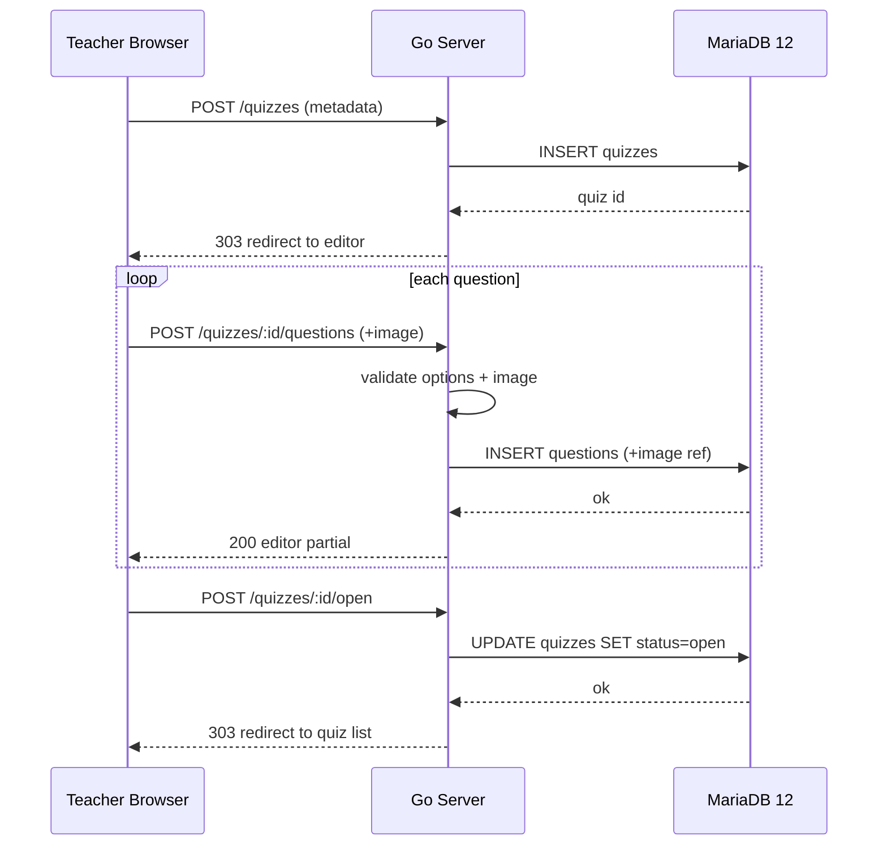
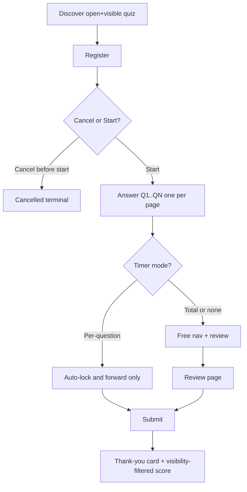
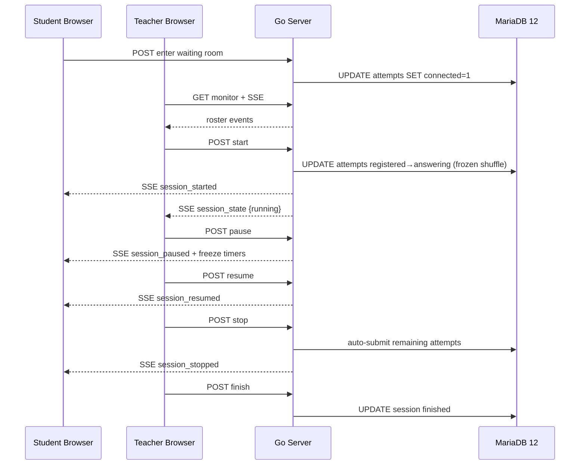

# Feature Flows — quiz-v2

Status: DRAFT | Owner: 01-BUSINESS | Updated: 2026-10-12

Canonical flow definitions. Business rules referenced as BR-### live in
`03-BUSINESS-RULES.md`. States live in `04-STATE-MACHINES.md`. Transport
operations live in `../02-ARCHITECTURE-AND-TECHNICAL/02-OPENAPI-SPEC.md`. Errors
live in `../03-RESILIENCE-AND-ERRORS/01-ERROR-MATRIX.md`.

## FLOW-001 — Teacher Creates Quiz with Questions

- **Actor:** Teacher. **Trigger:** Teacher opens quiz management and chooses
  "Create quiz". **Preconditions:** Authenticated teacher session.
  **Postconditions:** Quiz in configurable state with at least zero questions;
  only quizzes with >=1 question can be opened.
- **Purpose:** Author a daily quiz without external tools (REQ-001).

| Step | Owner | Input / Validation | Output / Side effect | Failure path |
|------|-------|--------------------|----------------------|--------------|
| 1. Open create form | Client (SSR page) | — | Empty form with defaults: status=draft, visible=true, type=normal, attempts=1, timer=none | Auth failure → ERR-001 |
| 2. Submit metadata | Client → Server `POST /quizzes` | Title 1–200 chars, optional description, type normal/matching (fixed at creation per BR-001), attempts 1–10 (normal) / forced 1 (matching), shuffle flags, timer mode+seconds, visibility flags, token toggle + code | Server validates (BR-002, BR-003), inserts `quizzes` row, returns redirect to question editor | Validation failure → ERR-100 series, form re-rendered with values preserved |
| 3. Add question | Client → Server `POST /quizzes/:id/questions` (DEC-107 supersedes DEC-095) | Type single/multiple/essay, prompt 1–5000 chars, options 2–10 for choice types with exactly >=1 correct flag, optional single image + optional alt text (see BR-010) | Server validates (BR-004, BR-005, BR-010 intake), stores row; image intake returns at once as `processing` and the background worker promotes to `ready`/`failed` (F-004); editor shows placeholder until `ready` and offers `Pratinjau` rendering the student view (prompt + image + options, no correctness). No intake key: the editor prevents doubles via button disable + in-flight `jqXHR.abort()`; a timeout-retry that still duplicates is removed by the teacher manually (delete question) | Image intake violation → ERR-103; queue full → ERR-112 (DECIDED S1a, 2026-10-14: `Retry-After: 1` header on 429 ERR-112 only — time-based retry; 409s are conflicts, not time-based, so no header there; AC-105 asserts the header); option rule violation → ERR-102. Trace: DEC-107; AC-102 |
| 4. Reorder/edit/delete | Same route family | Question IDs must belong to quiz; `type` NEVER editable after creation (BR-001 → ERR-106); draft always editable; on open+hidden with registered-only/cancelled-only rows, timer/shuffles/max_attempts/questions stay editable; on open+show with ANY row (registered/cancelled/answering/submitted) mutations to questions/timer/shuffles/max_attempts → 422 ERR-107; any answering/submitted row ANYWHERE (incl. hidden/closed) always freezes those fields (BR-006, DEC-103) | Mutations applied; frozen-quiz edit blocked | Type change → ERR-106; frozen edit → ERR-107 (AC-113, EDGE-065); delete-last of open quiz → ERR-108 (DEC-089) |
| 5. Open quiz | Server `POST /quizzes/:id/open` | Quiz has >=1 question, every choice question has >=1 correct option, AND at least one non-essay question (no essay-only checkbox — DECIDED Q9, 2026-10-14: an essay question has no answer key and cannot waive or satisfy the gradable-question gate) | `status=open`; quiz appears on student dashboard iff `visible=true` | Empty quiz or no non-essay question → ERR-108 |



Alternate paths: save-as-closed draft and resume later. Quiz duplication
(copy-as-new) is explicitly excluded from MVP (DECIDED DEC-010).

## FLOW-002 — Normal Quiz Student Lifecycle

- **Actor:** Student. **Trigger:** Student opens dashboard.
  **Preconditions:** Authenticated student; quiz `status=open`,
  `visible=true`, type=normal. **Postconditions:** One submitted attempt row
  with per-question answers, score, cheat count, timing.
- **Purpose:** Complete an asynchronous quiz (REQ-002).

| Step | Owner | Behaviour |
|------|-------|-----------|
| 1. Discover | Client renders open+visible list | Only quizzes matching predicate; hidden excluded (404 on direct access); closed+visible excluded from list but direct access renders 200 closed view ("sudah ditutup", no join) per BR-007 (DEC-115, EDGE-068, AC-226). |
| 2. Register | `POST /quizzes/:id/registrations` creates an `attempts` row with `state=registered` (R2: registration lives on the attempt row, no separate table) | One active (registered/answering) row per student per quiz. Duplicate → ERR-201. Closed mid-click → ERR-202. |
| 3. Cancel (optional) | `POST /registrations/:id/cancel` before start | Same row → `cancelled` (terminal). After start, cancel is rejected (BR-008). |
| 4. Start | `POST /quizzes/:id/attempts` | Same row `registered → answering`: server freezes question order permutation, per-question option permutation, per-question correct mapping snapshot (answer_key_json), question_snapshots + empty answers_json skeleton, deadline computed from timer mode (`attempt_deadline_utc`/`question_deadline_utc` sole truth, DEC-130). Review page empty. SSE stream for this attempt opened (`GET /attempts/:id/events`). |
| 5. Answer pages | `GET /attempts/:id/questions/:n` one question per page; `POST` answer per question | Per-question timer: auto-lock advances without back-navigation (BR-011). Total timer: free navigation + review; countdown display only, server enforces (BR-012; the countdown freezes under DEC-125 on BOTH triggers — dead-stream and matching pause — see FLOW-009). Note: fragment-wins and two-layer unsaved-draft semantics are canonical in ARCH/FRONTEND (DEC-122/123). Offline note (DEC-124): the dead-stream banner is generic plus a saved-tick; there is no per-answer unsent list. |
| 6. Review | `GET /attempts/:id/review` lists all N with answered/unanswered, jump links | Jump allowed only under total-timer or no-timer; per-question mode has no review of locked questions beyond read-only trail (BR-011). |
| 7. Submit | `POST /attempts/:id/submit` idempotent via server-generated key (DEC-084) | Server grades objectives immediately (BR-020), sets `state=submitted`, records `submitted_at`, closes the submitter stream (DEC-104). Duplicate submit → same result, no duplicate row (ERR-203 mapped to success echo). Submit received after the deadline (timer already auto-submitted) → `200` + the auto-submitted receipt (DEC-086), never an error. A `graded` SSE event fires only for viewers still on the final result page after submit (`GET /attempts/:id/result`) with an open stream; viewers on any other page — including the review page — get nothing live, and viewers with a closed stream get nothing live. |
| 8. Result card | `GET /attempts/:id/result` | Renders "Thank you for completing quiz <name>" plus temporary score / correct answers strictly per visibility flags (BR-030, BR-031). Essay pending shows "awaiting grading" placeholder. Result card never swaps in place: grade changes appear on next render (refresh/reopen), never by in-place update (DEC-104). Cancelled/revoked result card (DECIDED S5, 2026-10-14): a `cancelled` or `revoked` row
renders a terminal-state card — "Percobaan dibatalkan/dicabut", no score, no correct
answers, printable. No receipt is issued for never-present no-shows (`last_seen IS NULL`
registered rows) — recap already excludes them (DEC-088), and there is nothing to print.
AC-206 asserts this leg; S5 is closed. |



Timeout: total-timer expiry triggers server auto-submit from the timer
goroutine; the client SSE pushes `time_expired`, then navigates to the result
card. Server clock (`time.Now().UTC()`) is authoritative; the client
countdown is cosmetic (FLOW-009). Network loss during answering is covered in
fallback spec; answers
already POSTed are preserved.

## FLOW-003 — Matching Quiz Synchronous Lifecycle

- **Actor:** Teacher (controller) + N students. **Trigger:** Teacher opens a
  matching quiz. **Preconditions:** Quiz type=matching, status=open,
  visible=true. **Postconditions:** Session reaches `finished`; every occupant
  has a submitted attempt (auto-submitted on stop if needed).
- **Purpose:** Run a fully teacher-paced realtime quiz (REQ-006).

| Step | Owner | Behaviour |
|------|-------|-----------|
| 1. Register | Student `POST` registration | Same as normal; cancellation only before session start. |
| 2. Enter waiting room | `POST /matching/:id/enter`, then SSE `GET /matching/:id/events` | Server marks the occupant's `attempts` row present (`connected=1`, `last_seen` set, R2 roster = `state=registered` rows) plus the in-memory anon set. Count visible to teacher. Pre-start leave: `POST /matching/:id/leave` sets `connected=0` but keeps `last_seen` (row is still ever-present), broadcasts `occupant_left` (DEC-121, EDGE-071, AC-229). |
| 3. Teacher monitors | Teacher quiz monitor surface + SSE teacher stream | Roster of occupants, each with connection health. Two surfaces (DEC-110): the normal-attempt progress surface and the matching session-control surface. On matching quizzes with `per_question` mode there is no auto-advance; deadlines are recorded for recap accuracy and movement follows teacher cues only with a single monitor index (DEC-119, EDGE-070, AC-228). |
| 4. Start | Teacher `POST /matching/:id/start` | Session `waiting → running`; waiting room locks (new enters rejected ERR-301); server transitions all EVER-PRESENT occupant `registered` rows (`connected=1 OR last_seen IS NOT NULL`, DEC-088) to `answering` with frozen shuffle (R2: same-row transition, no new rows except entered memory anon intents, DEC-088); never-present rows stay `registered` marked no-show (never auto-submitted, revocable post-start); SSE `session_started` fans out; all present clients auto-navigate to Q1 simultaneously. |
| 5. Pause / Resume | Teacher `POST .../pause`, `.../resume` | Session `running → paused → running`. All timers frozen server-side (BR-013). Students see blocking modal, inputs disabled. SSE `session_paused` / `session_resumed`. |
| 6. Stop | Teacher `POST .../stop` | Session `→ stopped`. Server auto-submits every `answering` occupant attempt from last saved answers (never-present no-show `registered` rows untouched, DEC-088). SSE `session_stopped`. Students navigate to result cards. Waiting room stays locked. |
| 7. Finish/close | Teacher `POST .../finish` | Session `→ finished`. Quiz may then be closed/hidden. No further grading-state change except essay grading. |



Edge: student disconnects mid-running — attempt persists; on user refresh within
the running window the student resumes at the server-computed position
(F-002 notice + manual refresh, DEC-102 — no auto-reconnect, no polling);
if the session already stopped, the attempt is auto-submitted as-is.

## FLOW-004 — Anonymous Token Join

- **Actor:** Anonymous participant with a code. **Trigger:** Opens
  `/join?code=XXXXXX`. **Preconditions:** Quiz `token_enabled=true`,
  `status=open`. **Postconditions:** Persisted attempt labelled with entered
  name; no account row; ephemeral registration exists only in server memory
  for the quiz duration.
- **Purpose:** Low-friction participation without account management (REQ-007).

| Step | Owner | Behaviour |
|------|-------|-----------|
| 1. Enter code | Client validates 6–12 char alphanumeric (BR-040) | Unknown/closed/hidden quiz code → ERR-400 with identical message to avoid enumeration (hidden codes stop working, BR-040). |
| 2. Identify | Form: display name 1–100 chars, optional class label | Stored on the attempt as `taker_label` (with `student_id NULL`), never as a user. No password, no session cookie beyond a signed attempt token. Same display name (exact match) on the same quiz shares one `max_attempts` quota (DEC-091); different name = new participant. One-active rule (DEC-106, EDGE-067, AC-224): one `taker_label` holds at most one active (intent or answering) row per quiz; a second start while active → 409 active conflict (same message family as ERR-201), else quota exhausted → 410 ERR-208. |
| 3. Ephemeral registration | Server in-memory map `quiz_id → set(token)` | Evicted when quiz closes or after TTL 24 h; server restart invalidates pending (non-started) anonymous intents but never submitted attempts. TTL is an entry gate only (DEC-117, EDGE-069, AC-227): an answering attempt and its result card use row membership and never re-check TTL. Entered-anon presence is memory-only too (DEC-096): after a restart, entered anons re-identify (code+name) like pending intents; non-returners are never ever-present at start (DEC-088). |
| 4. Answer flow | Identical to FLOW-002 steps 4–8 (normal) or waiting-room join (matching) | Anti-cheat, timers, shuffle identical. Submit closes the submitter stream and result cards update only on next render (DEC-104). Attempt appears in teacher recap labelled `(anon) <taker_label>`. No history page for the participant; result card is the only receipt (printable). |

## FLOW-005 — Essay Grading and Score Finalisation

- **Actor:** Teacher. **Trigger:** Attempt submitted containing essays.
  **Preconditions:** Attempt `state=submitted`. **Postconditions:** Each essay
  has a 0–10 integer score; attempt has `final_score`; student sees final
  per visibility flags.

| Step | Owner | Behaviour |
|------|-------|-----------|
| 1. Queue | Server lists ungraded essays per quiz | Ordered oldest-first; count badge on teacher dashboard. |
| 2. Grade | Teacher `POST /attempts/:aid/essays/:qid/grade` with integer 0–10 | Server validates range (BR-021), stores, recomputes `final_score = objective_sum + Σ(essay/10)` (BR-022). Re-grade overwrites with audit log entry. |
| 3. Reveal | Student history/result re-render | Stream stays closed on submit (DEC-104): the `graded` event fires only for other viewers still on the final result page after submit (`GET /attempts/:id/result`) with an open stream — never on the review page. If `show_score=true`, final replaces temporary with "final" label on next render; if false, student sees only "awaiting release" until teacher enables. Result card updates only on next render — grade appears on refresh/reopen, never in place. Correct-answer reveal follows `show_correct` independently (BR-031). |

## FLOW-006 — Account Lifecycle

Seed → create → self-register → profile → deactivate/delete. Teacher scope (DEC-109):
a teacher manages self + teachers + students for CREATE — a teacher may create further
teacher accounts as well as student accounts (PRD §3: the seeded teacher creates further
teachers/students); any other teacher-to-teacher mutate (edit/deactivate/delete another teacher)
→ 403 ERR-003. First teacher comes from seed (credentials via environment, forced
password change on first login — BR-050). Student self-register creates
`role=student, status=active` immediately (no approval) then redirects to
`/login` — the student logs in manually (DECIDED DEC-087; no session is
created at register, so a mistyped email is caught at first login, and the
register endpoint never mints credentials). Deactivate blocks
login and terminates SSE/streams but preserves attempts — EXCEPT deactivate is
BLOCKED while the user holds `registered`/`answering` rows on an open quiz
(BR-051 guard, DEC-081) and BLOCKED while the target owns a running/paused matching
session (DEC-105, 409 ERR-115, EDGE-066, AC-223). Deactivate is REJECTED whenever
the target owns any `open` quiz — the auto-close clause is superseded
(Q3, N-A5, 2026-10-14) and no quiz is closed automatically by this path.
Delete is
two-step button confirm (deactivate → explicit dialog buttons, no typed text —
DEC-042) and follows retention
rule BR-052: attempts are anonymised, never silently dropped. Delete self is allowed for
both roles via inactive plus confirm (DEC-129).

## FLOW-007 — Live Monitor and Recap (DEC-110 two surfaces)

Two monitor surfaces (DEC-110): (a) normal-attempt progress surface — teacher sees rows for every `answering` attempt — student
name, current question index, last answer summary, review flag, cheat count
live, connection state. Row disappears on submit (spec: "ikut hilang").
(b) matching session-control surface — waiting-room roster pre-start + same progress rows during
running + start/pause/resume/stop/finish control buttons. Heartbeat + submit-vanish (DECIDED S4a/S4b, 2026-10-14): heartbeat payload shape is
`{server_now_utc}` at a 30 s beat with a single 60 s stale threshold (API-036, S4a; Q7
2026-10-14 — one number only, no second 45 s figure); submit-vanish
behaviour is that the answering row disappears from the monitor on submit (API-044 +
FLOW-007 + C-006 + AC-209, S4b). The vanish event name is declined per DEC-102 refresh
(no new event; row removal follows `occupant_left`-style). Stale-spinner timing
is DECIDED (Q7, 2026-10-14): ONE threshold, 60 s — the stale/slow signal and the
spinner clean-up both fire at 60 s without a fresh heartbeat (C-006/C-010 apply
that single number; no second 45 s threshold). Recap: per-quiz table of every submitted attempt (`state=submitted` only;
cancelled/revoked/no-show `registered` rows excluded, never-present no-show rows excluded from recap entirely (not submitted) per DEC-088 — student/anon label, per-question correctness,
objective score, essay score, final score, cheat count, duration,
submitted_at), newest attempt first, repeat attempts as separate rows (BR-014). Recap XLSX export honors window/class/q/date/status and IGNORES page/per_page (DEC-116).

## FLOW-008 — Anti-Cheat Detection Loop

Student client registers `visibilitychange`, `blur`, `pagehide` listeners.
Any transition to non-visible during `answering` state POSTs
`/attempts/:id/cheat` (beacon on hide) and increments `cheat_count`
atomically. Server returns new count; client shows blocking warning modal
("Perhatian — quiz mendeteksi halaman ini kehilangan fokus. Kejadian ke-N telah dicatat."). Teacher sees count in
monitor and recap. No auto-submit on cheat; no tolerance threshold in MVP
(BR-032). False positives (OS notification overlay without blur) are
documented as a known limitation; only events the browser reports as
hidden/blurred count.

```mermaid
sequenceDiagram
    participant B as Student Browser
    participant S as Go Server
    participant T as Teacher Monitor
    B->>B: visibilitychange hidden
    B->>S: POST /attempts/:id/cheat (beacon)
    S->>S: atomic increment cheat_count
    S-->>B: 200 {cheat_count: N}
    B->>B: show warning modal
    S-->>T: SSE occupant_progress {attempt,current_index,last_answer,cheat_count} (DEC-120; canonical name per API-036)
```

## FLOW-009 — Timer Enforcement (DEC-125 freeze: dead-stream AND matching pause)

Server spawns one goroutine per active timed attempt/session ticking at 1 s
granularity against `attempt_deadline_utc` stored at start. Per-question mode stores
`question_deadline_utc`; expiry locks the question (answer rejected ERR-205),
advances `current_index`, and pushes `question_locked` over SSE. The countdown freezes
(DEC-125): the client countdown freezes on BOTH triggers — on
matching pause, and on a dead stream (connection loss) where it stays frozen at the
last server sync and never invents ticks while disconnected. In both cases the
F-002 banner shape shows (a paused notice while paused; the dead-stream notice
while offline) and timers stay frozen server-side until resume (BR-013). Total mode
stores `attempt_deadline_utc`; expiry triggers the same auto-submit path as
manual submit with `auto_submitted=true`. Pause (matching only) shifts all
deadlines forward by the paused duration on resume (BR-013). Server clock
(`time.Now().UTC()`) is authoritative; client countdown is cosmetic and
re-synced from `server_now_utc` on every SSE heartbeat (30 s) and every
answer response.

Race precedence (DECIDED, commit order decides): per-question lock and total
expiry firing on the same tick → total wins (auto-submit, per-Q lock moot);
answer committed before pause commits stands AND the pause still succeeds
(both effects persist — the answer is saved, the session pauses); pause
committed first → the answer is rejected ERR-302 (EDGE-034). Stop-vs-answer:
answer committed before stop stands AND stop still auto-submits the remainder
(same both-effects-persist rule); stop committed first → the answer is
rejected with 410 ERR-204 (`attempt_closed`, the row is already submitted by
stop). Resume-vs-stop (both pass the ERR-116 same-verb guard as distinct
verbs): commit order decides via `session_version` — loser gets 409 ERR-300 +
current state; a post-stop answer is rejected ERR-204 as above. Students
whose stream is dead (F-002 notice, DEC-102) see no live event until they
refresh, so they systematically lose sub-second races versus live-stream
students — documented cost of no-poll degradation, never a correctness fork
(guards are server-side). Total-expiry typed-but-unsent text is lost with the
same explicit notice as EDGE-033.
