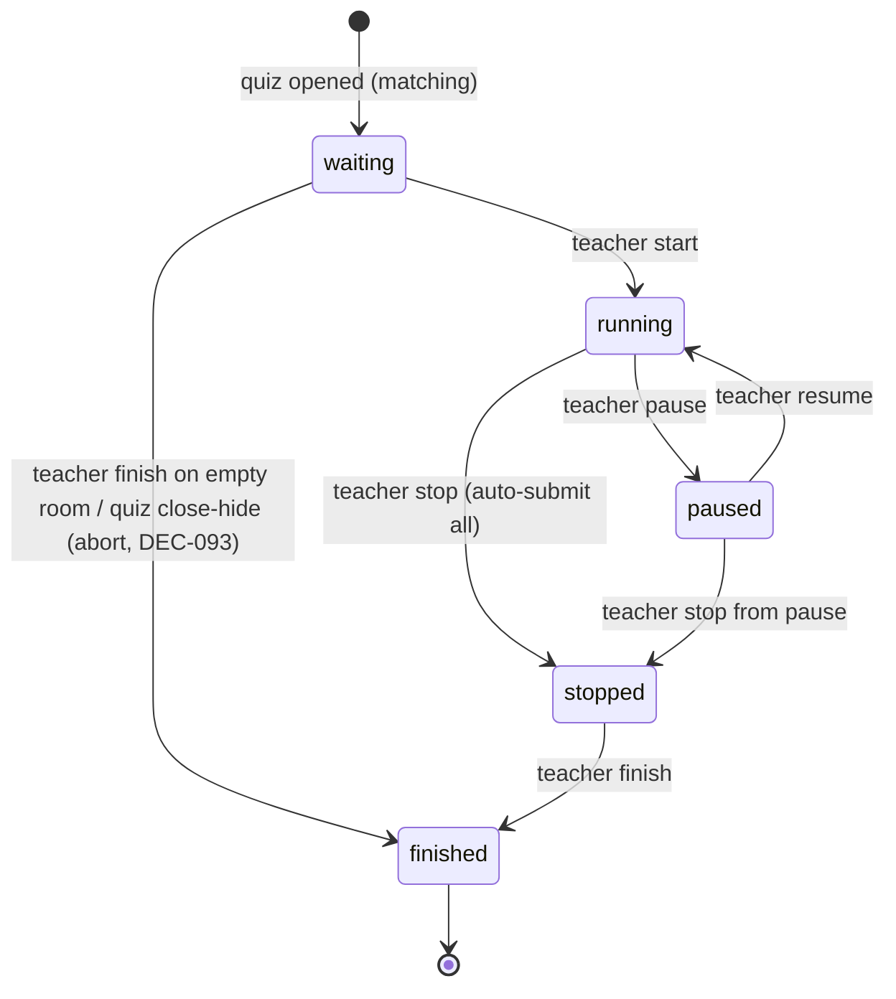

# State Machines — quiz-v2

Status: DRAFT | Owner: 01-BUSINESS | Updated: 2026-10-14 (F-35 closed: STATE-002 5-state model now labels `waiting leave` occupant-level and enumerates every valid exit)

Every state lists owner, persistence, entry/exit, guards, side effects, and
invalid-transition handling. Names are canonical across flows, API, schema,
and tests.

## STATE-001 — Attempt lifecycle (normal + matching occupant)

Owner: server + DB (`attempts.state`). Persisted: yes. Initial: `registered`
(created at register; R2 same-row lifecycle with STATE-003). Terminal: `submitted`.

```mermaid
stateDiagram-v2
    [*] --> registered : register
    registered --> answering : start (same-row transition)
    answering --> answering : save answer / cheat++ / heartbeat
    answering --> submitted : submit (manual or auto)
    answering --> submitted : session stop auto-submit
    submitted --> [*]
    note right of answering : per-Q lock advances index;\ntotal timer auto-submits at deadline
```

| State | Meaning | Entry | Exit | Guard |
|-------|---------|-------|------|-------|
| `registered` | Intent recorded, not yet started. No shuffle frozen. | Register transaction inserts the row (`state=0`). | Start, cancel, revoke. | Quiz open+visible, attempts remaining, no active row. |
| `answering` | Student may input per timer mode. SSE open. | Start transaction UPDATEs the same row, freezing shuffle snapshots + deadlines. | Submit / auto-submit / stop. | Quiz open (normal) or session running (matching); attempts remaining. |
| `submitted` | Immutable answers; grading may still pend essays. | Grading of objectives runs synchronously in submit transaction; `submitted_at`, `auto_submitted` set. | None (terminal for answers; essay grades update score columns only). | At least created; submit idempotent — repeat returns same receipt. |

Invalid transitions: `submitted → answering` rejected ERR-204 (e.g. back-button
POST). `answering → answering` after total deadline rejected ERR-206.
Recovery: crash mid-answering → row persists; on relogin student resumes at
server-side `current_index` with remaining time recomputed; crash
mid-submit → idempotency key decides single submission (see fallback spec).

## STATE-002 — Matching session lifecycle

Owner: server (quizzes row `session_state` + memory fan-out, R2: no session table). Persisted: yes.
Initial: `waiting`. Terminal: `finished`. DECIDED 5-state model — the five SESSION states are exactly `waiting`, `running`, `paused`, `stopped`, `finished`, and the rows below list every valid session-level transition between them. The `waiting leave` row is an OCCUPANT-level transition (one `registered` attempt row sets `connected=0`; the session itself stays `waiting`), so it is labelled as such and is not a sixth session state.



| Transition | Guard | Side effects |
|------------|-------|--------------|
| `waiting → running` | At least 1 occupant (DECIDED DEC-011: start with 0 occupants is BLOCKED with 422 ERR-113 + message "Belum ada peserta di ruang tunggu"); quiz open. | Lock waiting room; transition EVER-PRESENT occupant `registered` rows (`connected=1 OR last_seen IS NOT NULL`, DEC-088) to `answering` with frozen shuffle (R2 same-row; never-present stays `registered` no-show; only entered anon intents materialize, the rest expire by TTL); broadcast `session_started`; start timers. |
| `waiting → finished` (empty-room abort, DEC-093/094) | Teacher only; zero EVER-PRESENT occupants (empty room), OR quiz close/hide while `waiting` (auto-finish). | Broadcast `room_closed`; occupants' `registered` rows stay no-show and auto-revoke on quiz close (no revoke click needed); quiz may then be closed/hidden normally. |
| `waiting leave` (OCCUPANT-level, not a session transition — DEC-121, pre-start only) | Occupant in `waiting` only; once `running`, `POST /matching/:id/leave` is **REJECTED** (user decision 2026-10-14, N-A2) — it is NOT a 200 echo. DEC-126's "never an error" rule applies only to verbs issued while the session is still `waiting`. | `POST /matching/:id/leave` while `waiting` sets `connected=0` on the occupant's attempt row but keeps `last_seen` (the row is still ever-present for DEC-088 start) and the session stays `waiting`; broadcasts `occupant_left` (EDGE-071, AC-229). |
| `running → paused` | Teacher only. | Freeze deadlines (BR-013); broadcast modal; reject answers ERR-302. |
| `paused → running` | Teacher only. | Shift deadlines; broadcast resume; re-enable input. |
| `running → stopped` AND `paused → stopped` (the ONLY two exits into `stopped`) | Teacher only. | Auto-submit all `answering` rows from last saved answers (never-present no-show `registered` rows untouched, DEC-088); broadcast `session_stopped`; keep room locked. |
| `stopped → finished` | Teacher only. | Release summary; quiz may be closed/hidden afterwards. |
| `running/paused → finished` (direct, skipping stop) | Teacher only. | 409 ERR-300 + current state (finish is only valid from `stopped`); the teacher clicks stop first. No implicit stop-then-finish. |

Invalid: student-triggered transitions (403); `waiting → paused/stopped`
(only `waiting → running` and the DEC-093 empty-room `waiting → finished`
abort exist — the complete valid-exit list for `waiting` is those two, plus the
occupant-level `waiting leave` above);
`finished → *`; direct `running/paused → finished` → 409 ERR-300 (finish valid
only from `stopped`); `stopped → running/paused` (no un-stop: a stopped session
proceeds to `finished` or is abandoned, never resumed). 200-echo waiting verbs (DEC-126): idempotent waiting-room
verbs (enter/leave/monitor re-reads) return 200 echo with current roster, never an
error (EDGE-072, AC-231). This 200-echo rule applies ONLY while the session is
`waiting`: a `leave` POST after the session is `running` is rejected per the
`waiting leave` row above (user decision 2026-10-14, N-A2). The SAME verb repeated within 10 s of its previous acceptance
is rejected 429 ERR-116 with the current state, changing nothing — but ONLY when
the repeat carries a stale `session_version` (accidental double-click shape);
a repeat with the current version (client re-read, then re-POSTed) → 200 echo,
never 429 (DECIDED DEC-085, refined R8 — enforced in-memory per quiz, reset on
restart). After 10 s, a repeated same-state verb is a 200 echo (same state event
re-broadcast, no duplicate attempts); a state-changing verb on a stale
version is 409 ERR-300 + current state. **ERR-116 restart-reset (DECIDED, S3 closed 2026-10-14):** the 10 s same-verb guard is in-memory per quiz and does NOT survive process restart — after a restart the guard window is reset, so a same-verb repeat that was previously rejected may now be accepted (echo-vs-409 applies on its merits). The 409 state-conflict guards (ERR-300) are unaffected: they are persisted and always apply. Accept in-memory loss; close S3. See the **AC-114** restart leg (the earlier AC-112 reference is corrected per user decision N-C1 2026-10-14).

## STATE-003 — Registration lifecycle (on the attempt row, R2)

Owner: server + DB (`attempts.state` codes 0/3/4). Initial: `registered` (0).
Terminals: `cancelled` (3), `revoked` (4); the same row later advances `registered → answering` at start (see STATE-001).

```mermaid
stateDiagram-v2
    [*] --> registered : register
    registered --> cancelled : student cancel (pre-start)
    registered --> revoked : teacher revoke (pre-start; plus DEC-088 never-present no-show post-start)
    registered --> answering : start, continues in STATE-001
    cancelled --> [*]
    revoked --> [*]
```

Guards: cancel/revoke only while the row is still `registered` (no frozen start snapshot yet — BR-008). Exception DEC-088: the teacher may still revoke a never-present no-show row (`last_seen IS NULL`, no frozen snapshot) even after session start — the only post-start revoke; `answering` rows are never revocable. Re-register after cancel creates a NEW `attempts` row (history preserved, `attempt_no` increments). Exhaustion race (DEC-083): a start that finds attempts exhausted auto-cancels the stranded `registered` row in the same transaction (410 ERR-208 + audit row).

## STATE-004 — Quiz availability (orthogonal codes, not one enum)

Two independent persisted TINYINT codes — do NOT model as a single enum (R2 stores codes; words below are canonical names):

- `status ∈ {draft, open, closed}`: draft → open (needs BR-005) → closed.
  Closed accepts no new registrations/starts; in-flight attempts continue to
  submit under their frozen deadlines. Reopen closed → open allowed if
  questions still valid.
- `visible ∈ {true, false}`: toggles student-dashboard listing instantly;
  hidden quizzes return 404 hidden response to students but remain fully manageable by the
  teacher. Closed+visible quizzes return 200 closed view ("sudah ditutup", no join) on
  direct access but are excluded from the discover list (DEC-115, EDGE-068, AC-226);
  closed+hidden returns 404. Close/hide while the matching session is `waiting` auto-finishes it
  (DEC-093 abort, SSE `room_closed`); close/hide while `running`/`paused` →
  409 "hentikan sesi dulu" (stop first, DEC-093); `stopped`/`finished` close
  normally.
- Matching adds session state (STATE-002) orthogonally: a quiz can be
  `open+visible` with session `finished` (shows as ended, joinable for recap
  only if `show_score`). finished-permanent (DEC-127): once `finished`, the session
  never resets on quiz reopen — reopening closed → open keeps session `finished`
  (EDGE-073, AC-232); a new run needs a new quiz. No reset on reopen, ever.

## STATE-005 — Essay grading per question

`ungraded → graded`, with `graded → graded` allowed (re-grade overwrites +
audit). Owner: teacher. Entry: submit leaves each essay entry in `answers_json` with `grade=null` (including empty). Exit: grade in 0–10 (BR-021). Attempt `final_score`
recomputed on every transition. No terminal lock: re-grade always possible
until quiz deleted.

## STATE-006 — User account

`active ↔ inactive → deleted`. Owner: server. Seeded teacher starts active
with `must_change_password`. Deactivate revokes sessions/streams immediately
and attempt rows persist (fairness: a deactivation mid-quiz does not wipe
answers) — EXCEPT deactivate is BLOCKED
while the user holds any `registered`/`answering` row on an open quiz
(DECIDED DEC-081, BR-051 guard; blocked → 409 ERR-115, changing nothing).
Delete only from inactive with
two-step button confirm (explicit dialog buttons, no typed text — DEC-042);
attempts anonymised per BR-052.

## STATE-007 — SSE stream (per viewer, ephemeral)

`connecting → open → closed`. Owner: browser + server hub.
Not persisted. Heartbeat 30 s; presence-stale threshold 60 s (`last_seen`
older than 60 s renders the occupant offline, row kept); ever-present means
`connected=1 OR last_seen IS NOT NULL` at session start (DEC-088) — a stale
occupant (offline at start but entered before) STILL counts as ever-present
and transitions to `answering`; only never-entered rows (`last_seen IS NULL`)
are no-show; server closes on submit/stop/finish,
deactivation, or quiz close. **Presence-stale leg (DECIDED per audit finding N3, 2026-10-14):** an occupant whose `last_seen` is older than 60 s at teacher stop is STILL ever-present — it auto-submits from last saved answers like any present occupant (AC-154 leg). The no-show exclusion applies ONLY to rows with `last_seen IS NULL` (never entered). A >60 s-stale occupant is never treated as a no-show; refresh-within-60 s (AC-153) and present-never-returns (AC-154) are the two covered legs, and this stale leg is the third, now decided. There is NO `reconnecting` state and NO replay:
on stream `error` the client calls `EventSource.close()` immediately
(disabling native auto-retry, which would otherwise retry silently), and on
45 s without a frame the client closes the stream — both paths show the
persistent F-002 dead-stream notice and end in `closed`. `closed` is terminal
per page lifecycle; only a user page refresh creates a new stream, re-rendered
from server truth (F-002 recovery path), never assuming pre-close events.
A process restart kills all streams; clients notice via error or 45 s silence
and refresh. S4 heartbeat payload shape (DECIDED S4a, 2026-10-14): every stream emits
a `heartbeat` event every 30 s carrying `{server_now_utc}` — the S4a payload is
DECIDED and FINAL (user decision 2026-10-14) and the shape is canonical in answer
envelopes per API-036. Single stale threshold (DECIDED Q7, 2026-10-14): ONE number for the stale signal,
60 s — the stale/slow signal (C-006) and the C-006/C-010 stale-spinner clean-up both
fire 60 s after the last fresh heartbeat; the stale signal carries no second figure
(the 45 s above is the dead-stream silence timeout, a different and unchanged
mechanism, not the stale signal).
Submit-vanish (S4b) is also DECIDED: the answering row disappears from the monitor
on submit (API-044 + FLOW-007 + C-006 + AC-209). No residual open question remains
for S4 — the heartbeat payload shape and the stale-spinner timing are both decided,
so C-006/C-010 markers that still read DECISION REQUIRED are stale.

Concurrency/versioning: all mutating transitions use
`UPDATE ... WHERE state=<expected>` optimistic checks inside transactions;
loser receives 409 ERR-300 with current state so the client re-syncs instead
of forking state.
