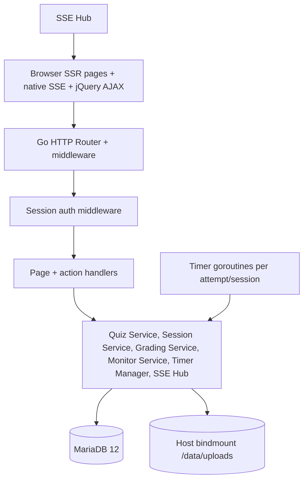
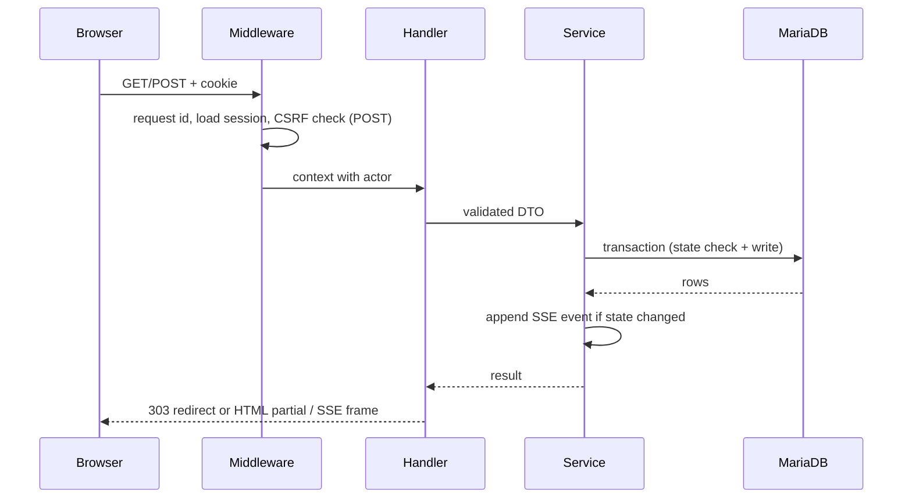

# Architecture Overview — quiz-v2

Status: DRAFT | Owner: 02-ARCHITECTURE | Updated: 2026-10-14 (Q10 applied: ARCH §4/§6 reconcile ERD `attempt_deadline_utc`; F-50 429 shape precedence; F-51 S6 pointer; F-52 paused-session sweep exclusion; **N-B6 applied: the "engineer scope" claim is withdrawn — no separate engineer role exists in this system; the scope is the primary developer's, and overload behaviour is owned by `../03-RESILIENCE-AND-ERRORS/02-FALLBACK-STRATEGY.md`**)

## 1. Decisions (all DECIDED by user unless marked)

| ID | Decision | Justification |
|----|----------|---------------|
| ARCH-001 | Go monolith on the **Fiber** web framework (DECIDED DEC-020; Express-inspired, fasthttp-based (zero-allocation is a vendor design note, not a tested budget, per official docs); SSR HTML via the official template-engine middleware `c.Render` pattern), single binary + Docker image. Named engine: the **`html/template` v3.x** engine (`template/html_v3.x.x`, `c.Render(..., "html")` — Go stdlib, no cgo, no second engine) is the ONLY template engine mounted; the other catalogued engines (`ace`, `amber`, `django`, `handlebars`, `jet`, `mustache`, `pug`, `slim`) are NOT used. Each grounded companion's applied surface (all exist in the supplied `GO-FIBER-DOCS.md` URL catalog): sessions (`fiber-v3-sessions-cookies`) + storage drivers (`fiber-v3-storage-packages`) → server-side login sessions + CSRF token storage (ARCH-005, BR-054); `CSRF` + `Security middleware stack` (`fiber-v3-security-middleware-stack`) → global CSRF on POST, cheat-beacon exemption only (DEC-108), security headers per infra/security spec; file uploads (`fiber-v3-file-uploads`) → multipart intake on API-023 only (BR-010); structured logging (`fiber-v3-structured-logging` JSON shape) → single `slog`-style JSON line per request carrying `request_id`/`X-Request-ID`; graceful shutdown (`fiber-v3-graceful-shutdown` guide + `recipes/graceful-shutdown`) → drain of HTTP, SSE, timer goroutines and the 2-worker image pool on SIGTERM; template engines (`fiber-v3-template-engines` + `template/html_v3.x.x`) → `c.Render` on every SSR page; testing patterns (`fiber-v3-testing-patterns`) → `app.Test` for the AC suite. The `Rate limiting` guide (`fiber-v3-rate-limiting-guide`) is explicitly NOT applied (DEC-073: no rate limiting in MVP). | Simplest deploy for one school; full control of sessions/cookies; Fiber gives fasthttp throughput with stdlib-compatible handler logic for the stated envelope (≤500 users, ≤100 concurrent SSE streams). Rejected: chi/echo/Gin (no validated need to differ; Fiber's session/storage/upload/logging guides already cover every platform requirement here), net/http-only (reinvents the session/CSRF/upload/logging surface the guides provide), SPA+API split (double auth surface, no offline need). Carrier (DEC-114): full jQuery 4.0.0 allowed EXCEPT SSE/EventSource, sendBeacon, SPA/router (native-only). |
| ARCH-002 | MariaDB 12.3.x current GA (example `mariadb:12.3`; exact patch pinned at build time in Compose) as system of record; no cache tier in MVP. Go connects via `database/sql` with an explicit MariaDB/MySQL-compatible driver (DECIDED companion to DEC-020: Fiber has no ORM of its own and the spec stays boring-SQL; exact driver module + version pinned at build time in `go.mod`). | Recap queries are small (tens of students); avoids cache-invalidation gaps. |
| ARCH-003 | Realtime = SSE (server→client, NATIVE `EventSource`) + POST (client→server, jQuery AJAX where JS present; native `sendBeacon`/fetch-keepalive ONLY for the cheat beacon — DEC-108 beacon sole native exception stays), push latency budget <2 s CONFIRMED (DECIDED DEC-023; UI-002 carrier split). | Fan-out control (start/pause/stop) and monitor updates need server push with cookie auth; SSE is native to HTTP/SSR, no handshake complexity. WS rejected: no sub-second game sync needed. |
| ARCH-004 | Single instance; in-memory SSE hub + anonymous-intent map + timer goroutines + bounded in-process background worker pool for image intake (2 workers, queue 100, DECIDED DEC-021; NOT a distributed queue). | Single-school tens-of-concurrency fits one process; distributed state/queues would invent sophistication. Multi-instance explicitly out of scope. |
| ARCH-005 | Cookies + server sessions (signed session id, HttpOnly, SameSite=Lax, Secure in prod — TLS terminates at Cloudflare per ARCH-009). No JWT-in-localStorage. Fiber session storage per `fiber-v3-sessions-cookies`; 60-minute sliding idle expiry (BR-054). | SSR-friendly; immune to XSS token theft vs localStorage; logout = server delete; password change revokes other sessions in realtime (BR-054). |
| ARCH-006 | Images on host-bindmounted dir (`data/uploads/` → `/data/uploads`, DEC-101), served via signed Go handler, NOT a public static dir. Vendored third-party assets (`/static/bootstrap/`, `/static/jquery/jquery-4.0.0.min.js` OBSERVED in `assets/jquery-4.0.0/`, `/static/fonts/gotham-rounded/`) ship inside the image (UI-001/002/005). | Access control per quiz visibility; avoids leaking hidden-quiz images; exam pages never depend on CDN. |
| ARCH-007 | XLSX export via Excelize (`github.com/xuri/excelize`, pure Go, DECIDED companion to DEC-002; module + version pinned in `go.mod` at build time). Streaming row writer (`NewStreamWriter`, ascending rows, `Flush`) for the recap SELECT — no full in-memory materialization; styling limited to header bold + freeze pane. No CSV/PDF writers in MVP. | Pure-Go (no cgo, single binary intact); streaming API is documented for huge worksheets; one format, one library, recap-shaped output. |
| ARCH-008 | HTTP response caching is specified transport-level only (DECIDED by user 2026-10-14: follow-up to the caching interview, all four user rules preserved). ONE owner: **Go Fiber sets every response header** — no second component, no NGINX directives, no CDN in MVP. Class A asset bytes under `/static/…` (build assets: vendored Bootstrap CSS/JS, jQuery, Gotham fonts) get a SHORT shared TTL (1 day, `public, max-age=86400`) because the suite forbids a build step (UI-002/§3) so filenames stay version-stable, not content-hashed. Class B images are per-attempt private bytes served by the signed handler under `/uploads/:ref` (ARCH-006), never public, browser-private caching only. Class C = ALL SSR HTML + SSE + `/metrics` + `/healthz` + `/readyz` + XLSX export: `no-store` unconditionally, because every page is user-, owner-, attempt- or quiz-scoped (RBAC R1/R2, BR-007/006, DEC-030/031) and DEC-102/DEC-104 make page-refresh the canonical freshness mechanism. Domain-wide Cache Everything is PROHIBITED. | Caching is transport metadata, not a cache tier: ARCH-002's "no cache tier in MVP" (§5 "No derived caches") stays intact because no query result, derived row, or object is ever stored. SSR cost is cut at the exact place it is safe to cut (asset bytes, which are identical for every user) while every personalized page remains uncached, so no cross-user leak and no stale-answer risk is introduced. |
| ARCH-009 | NGINX is REMOVED (DECIDED by user 2026-10-14, superseding DEC-022): the Docker `app` container is exposed to the internet through **Cloudflare** directly — no reverse proxy in the deployment. Consequences owned by this row: (a) TLS terminates at Cloudflare (`Full (strict)` mode, operator-owned origin certificate — specifics deferred to the operator runbook like every other TLS detail); (b) `proxy_buffering off` and the ≥90 s keepalive DO NOT EXIST, so SSE has no buffering protection and Cloudflare's connection limit is an accepted, unmitigated risk — the polling fallback (EDGE-035 refresh rebuild) is the only recovery; (c) `/metrics` is no longer proxy-hidden, so it MUST be firewalled at the host (bound to an internal interface only, never published); (d) `Secure` session cookies still required in prod (Cloudflare must serve HTTPS). | The operator already fronts the school server with Cloudflare, so a second TLS terminator duplicates work and adds a failure mode. Removing it also removes the buffering hazard for SSE that `proxy_buffering off` was there to fix. The cost is real and accepted: long-lived SSE streams are at the mercy of the edge's connection limit, which the refresh-rebuild path already covers. |

Rejected alternatives: SPA+API split (double auth surface, no offline need);
WebSocket hub (unjustified); Redis/pub-sub (no multi-instance); BaaS
(lock-in, weak transactional grading); Fiber prefork mode (separate processes
break in-memory SSE hub/timers/worker pool — single process is the design);
microservices/distributed queues/circuit breakers
(explicitly NOT APPLICABLE — single process, single DB, bounded in-process worker pool only).

## 2. Runtime components (single process)

| Component | Responsibility | Ownership |
|-----------|---------------|-----------|
| Router + middleware | Request IDs, logging, session load, CSRF check on POST (DEC-108 cheat-beacon exemption per API-000), panic recovery. | Platform |
| Quiz Service | CRUD quizzes/questions, visibility predicate, freeze guard BR-006 (DEC-103 mirror: open+hidden+registered-only editable; open+show+any row frozen; answering/submitted always frozen). | Business |
| Attempt Service | Register/start/answer/review/submit, shuffle snapshot, idempotency keys. | Business |
| Session Service (matching) | Waiting room set, start/pause/stop/finish state machine, fan-out events. | Business |
| Grading Service | Objective grading BR-020, essay grades BR-021, totals BR-022 — always in the submit/grade transaction. | Business |
| Timer Manager | One goroutine per active timed attempt/session; fires lock/advance/auto-submit; shifts deadlines on pause. Paused sessions are EXCLUDED from every sweep — the boot recovery sweep (F-003) skips `session_state=paused` rows, so a restart while paused can never auto-submit a frozen occupant, and past-due timers belonging to a paused session do not "fire immediately" on respawn; on resume the server shifts deadlines by the full paused duration. | Platform |
| SSE Hub | Per-quiz channels, heartbeat 30 s, presence for monitor. No replay buffer, no auto-reconnect (DEC-102) — dead streams end; refresh rebuilds. | Platform |
| Monitor Service | Builds teacher monitor rows from attempts + presence; never exposes other students' answers to students. Normal monitor + matching live rows = `GET /teacher/monitor/:quizId` + `/events` (API-044); matching control + SSE = `GET /teacher/matching/:id` + `/events` (API-042, DEC-110). | Business |

Trust boundary: browser is untrusted. All of time, order, correctness,
visibility, and scoring are re-derived server-side; client payloads are hints.

## 3. Request lifecycle (SSR + SSE)

POST-then-redirect (PRG) for page forms; jQuery-AJAX + HTML-partial for per-question
saves (progressive enhancement: full form submit works without JS except SSE
live features and cheat detection, which degrade to documented fallbacks).
Fragment rule (DEC-111/112/113): search-q uses AJAX fragment (requests
carrying `X-Requested-With: XMLHttpRequest` receive ONLY the table/cards HTML
fragment); other filters use SSR GET unless a fragment is needed; history
updates are `replaceState`-only.

## 4. Synchronous vs asynchronous

Everything user-visible is synchronous request/response except: (a) SSE fan-out
(start/pause/stop/monitor/cheat/heartbeat) — async push, non-replayable, <2 s
budget (DEC-023), consumed by NATIVE `EventSource` only (never jQuery —
UI-002); a dead stream ends with the F-002 notice and only a user refresh
rebuilds state (DEC-102: no auto-reconnect, no replay, no polling); async split
note (DEC-104): closes SSE stays, result renders on next render; jQuery rule
(DEC-114 carrier): full jQuery 4.0.0 allowed EXCEPT SSE/EventSource,
sendBeacon, SPA/router (native-only); (b) timer goroutines — in-process async, transactional effects;
(c) image compression/conversion — bounded in-process background worker pool
(2 workers, queue 100, 10-min item timeout; DECIDED DEC-021 — F-004). The pool
is created at boot, drained on graceful shutdown (Fiber graceful-shutdown
guide); queue-full returns 429 + retry-later JSON (form path: inline error,
answer flow unaffected).

Queue-full (429 ERR-112) response-shape precedence — the ONE rule for every 429,
including multipart image intake:

| Caller | Response shape | Precedence |
|--------|----------------|------------|
| JSON/`Accept: application/json` (API-023 AJAX without an image) | 429 + `Retry-After: 1` + ERR-112 JSON envelope | JSON envelope wins; the client parses the envelope and retries once. |
| Multipart form path (API-023 with an image, page form POST / `X-Requested-With: XMLHttpRequest`) | 429 + `Retry-After: 1` + the ERR-112 **inline HTML field error** rendered back into the question-editor form | Inline HTML wins for multipart: the multipart body is already parsed by the upload middleware, so the response re-renders the editor form with the field error instead of a JSON envelope. |
| Answer flow (API-035) | Never queue-full — intake is the only 429 path | Answer flow is unaffected by design; no image-dependent 429 exists there. |

`Retry-After: 1` is present on the 429 path only (time-based retry, DECIDED S1a);
409 responses are conflicts and never carry the header.

## 5. Data ownership and source of truth

MariaDB owns: users, sessions, quizzes (incl. live session columns), questions (options embedded), attempts (registrations, answers, grades, cheat evidence embedded), audit log. Memory owns (ephemeral): SSE connections, presence, anonymous pre-start intents, timer handles (deadlines ALSO persisted so restart recovers). Disk owns: image bytes (DB owns references). No derived caches; dashboards query directly with stated indexes. Zero FOREIGN KEY clauses — all references are app-enforced (R2).

## 6. Deployment assumptions

One Docker image (Go Fiber binary + templates + static incl. vendored Bootstrap pair from `/static/bootstrap/`, jQuery 4.0.0 from `/static/jquery/` OBSERVED in `assets/jquery-4.0.0/` — full jQuery 4.0.0 allowed EXCEPT SSE/EventSource, sendBeacon, SPA/router native-only per DEC-114, no-CDN — and Gotham Rounded fonts from `/static/fonts/gotham-rounded/`), one MariaDB 12.3.x current GA container (example `mariadb:12.3`, exact patch pinned at build time; DEC-118)
via Compose, host bindmounts `data/` for uploads + DB data (DEC-101; container
paths unchanged). **Edge: Cloudflare (DECIDED ARCH-009, 2026-10-14, superseding
DEC-022) — NGINX is removed from the deployment.** No orchestrator,
no replicas, no service mesh. Capacity envelope: ≤500 users total, ≤100
concurrent SSE streams, ≤10 parallel timed sessions; push fan-out <2 s (DEC-023);
overload behaviour defined in fallback spec.
- S6 (CI trio — RESOLVED 2026-10-14 per §5b, owner: ARCH §6 + CICD + AC-136):
  the canonical trio is owned by `05-DEVOPS-AND-INFRA/02-CICD-SPEC.md` §3/§4
  (integration DB = MariaDB 12.3.x current GA service in CI, sqlite for local dev
  runs only with a divergence runbook; deploy-fail = rollback blip, not continued
  serving of the previous version; no coverage waiver — DEC-001 gates stay
  enforced). The deploy/proxy/smoke gate is `/readyz` (observability §3 contract),
  not `/healthz` (liveness only). ARCH §6 carries only the pointer — the CICD
  file owns the wording and the smoke-gated rollback detail.

## 7. Key trade-offs

- SSE over WS: simpler auth, push budget <2 s DECIDED (DEC-023); cost: separate POST path (accepted).
- SSR over SPA: fewer moving parts, works with JS partially disabled; cost:
  per-question full-page option documented as acceptable (progressive
  enhancement via jQuery AJAX).
- No ORM/cache/queue: auditability and zero invalidation bugs; cost: SQL must
  be hand-tuned (indexes specified in schema doc).

## 8. HTTP response caching (DECIDED ARCH-008, 2026-10-14)

User's four rules are preserved and each is mapped to the route class that
actually exists in this suite (§1 ARCH-001..009, §6). One owner for every
header: **Go Fiber**. There is no second owner and no edge-side caching in MVP.

### 8.1 Cache classes

| Class | Route surface | Cache eligibility | Browser TTL | Origin header (Fiber) |
|-------|---------------|-------------------|-------------|------------------------|
| **A** — build assets | `/static/bootstrap/…`, `/static/jquery/…`, `/static/fonts/gotham-rounded/…` | Eligible (`public`) | **1 day** (`max-age=86400`) | `Cache-Control: public, max-age=86400` |
| **B** — uploaded question images | `GET /uploads/:ref` (PRD/ARCH-006 signed handler) | Browser-**private** only, never shared | 1 day, revalidated | `Cache-Control: private, max-age=86400, must-revalidate` + `ETag` and `Last-Modified` always present |
| **C** — SSR HTML + streams + binaries | every non-static page, all `…/events` SSE, `/metrics`, `/healthz`, `/readyz`, `GET …/recap.xlsx` (API-063) | **Never** | none | `Cache-Control: no-store` |

Rules 1–4 mapped to the real surfaces, because the suite contains no
`/assets/` or `/media/` prefix anywhere (verified by grep across all 21 files):

- **Rule 1 (build assets)** → applies to Class A. **User-rule exception:** the
  origin is `public, max-age=86400`, NOT `max-age=31536000, immutable`. The
  1-year branch of the rule is conditioned on hash-based filenames, and the
  suite forbids a build step (UI-002 §3: "no npm/vite/webpack/parcel build step
  in MVP") so filenames stay version-stable (`bootstrap.min.css`,
  `jquery-4.0.0.min.js`). A 1-year immutable TTL on version-stable names would
  serve stale bytes for a year after any vendored swap, so the rule's `if` branch
  is not satisfied and its `immutable` value is not applied. Adopting hashing
  later is a new decision; when it lands the A-class header becomes
  `public, max-age=31536000, immutable`.
- **Rule 2 (versioned media)** → **NOT APPLICABLE today** (user decision
  "tidak perlu folder media, di skip"): no `/media/` prefix, no media directory,
  and no versioned-media asset exists in the suite. Rule 2 is recorded verbatim
  as the reserved policy so that creating `/media/` later does not need a fresh
  design: eligible only for URLs that are genuinely immutable (content-addressed
  filenames), 1-year edge TTL, and mutable-URL variants must never be marked
  `immutable`.
- **Rule 3 (uploaded images)** → applies to Class B, with the user's ETag /
  Last-Modified requirement honoured: the signed handler MUST emit a valid
  `ETag` and `Last-Modified` on every `200` and MUST emit `304` on a matching
  `If-None-Match` / `If-Modified-Since`. Because the user chose "always a new
  address on replace" (BR-010 random-filename promotion), a given URL's bytes are
  genuinely immutable, so revalidation is an optimisation, not a correctness
  requirement. B-class bytes are still an authorization decision (quiz access
  check), so they are `private` — never `public`, never shared-cached.
- **Rule 4 (SSR HTML and personal pages)** → applies to Class C, in full.
  Domain-wide **Cache Everything is PROHIBITED**. Every HTML page is auth- or
  ownership-scoped (RBAC R1/R2, BR-006/007, DEC-030/031, API-000 guard column),
  so the whole class is `no-store`.

### 8.2 Mandatory bypass list (Class C, never cacheable)

`/login` · `/register` · `/join?code=…` (+ the identify step) · `/` (role
dispatch) · `/change-password` · `/student` · `/student/history` ·
`/attempts/history` (API-039b) · `/student/profile` ·
`/attempts/:id/questions/:n` · `/attempts/:id/review` ·
`/attempts/:id/result` · `/matching/:id/waiting` · `/teacher` ·
`/teacher/quizzes` (+ `/new`, `/:id/edit`) · `/teacher/matching/:id` ·
`/teacher/monitor/:quizId` · `/teacher/quizzes/:id/grading` ·
`/teacher/quizzes/:id/recap` · `/teacher/users` · `/teacher/profile` ·
`/uploads/:ref` (B-class is not in the bypass list — it is revalidated, see 8.1) ·
every `…/events` SSE endpoint (API-036/041/042/044) · `/metrics` · `/healthz` ·
`/readyz` · `GET …/recap.xlsx` (API-063) · every POST, including the cheat
beacon (DEC-108 CSRF-exempt) — POSTs are never cached.

Includes the query-string variants (`?q/`, `?page/`, `?per_page/`, `?window/`,
`?date/`, `?status/`, `?class/`, `?cursor/` …): the cache key does not rescue
them because the *authorization* result differs per session, so every such URL is
`no-store` too.

### 8.3 Freshness contract

`no-store` is what keeps DEC-102 (server truth rebuilds on refresh) and DEC-104
("result card never swaps in place: grade changes appear on next render") true.
Any cache TTL on Class C — including a short one — would make the canonical
recovery mechanism serve stale state and is therefore forbidden by design, not
by tuning.

### 8.4 Compression (DECIDED 2026-10-14 by user: "Ya, pasang gzip")

Fiber's `compression` middleware, `gzip` level default, applied to
`text/html`, `text/css`, `application/javascript`, `application/json`,
`text/event-stream`, `font/*`, `image/svg+xml`. SSE (Class C) is compressed as
part of the same middleware — with no proxy in the path (ARCH-009) there is no
`proxy_buffering off` to preserve, and gzip on `text/event-stream` writes are
not expected to introduce buffering delay (accepted cost, user decision).
The A-class TTL exception does not extend to compression: assets stay
compressible at any TTL.

### 8.5 What this does NOT introduce

No cache tier (ARCH-002 "no cache tier in MVP" is unchanged and still binding);
no derived/query cache (§5 "No derived caches; dashboards query directly" is
unchanged); no CDN **caching** is relied upon anywhere (this is browser +
origin headers only — Cloudflare per ARCH-009 terminates TLS but is pinned to
being unable to cache any class: A is `public` at the browser with no
edge-asserted TTL, B and C are `private`/`no-store`); no NGINX
directives (ARCH-009 removed the component). Invalidation is not a concern for
Class C (`no-store`) and for Class B (new URL per replace, per BR-010 + user
decision); Class A's 1-day window is the only staleness exposure and it is
bounded to vendored bytes that only change at image build time.

References: transport contracts → `02-OPENAPI-SPEC.md`; schema →
`03-ERD-DATA-SCHEMA.md`; permissions → `04-RBAC-MATRIX.md`; infra →
`../../05-DEVOPS-AND-INFRA/01-INFRA-TOPOLOGY.md`.
