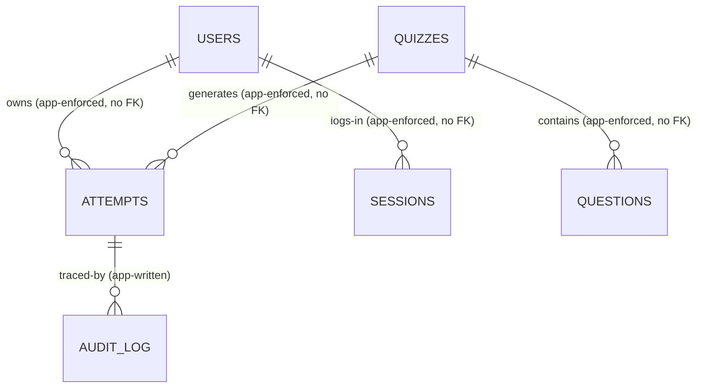

# Data Schema — quiz-v2 (MariaDB 12.3.x current GA, denormalized)

Status: DRAFT | Owner: 02-ARCHITECTURE | Updated: 2026-10-14 (Revision R2 + N5 applied; Q10 canonical column names `attempt_deadline_utc`/`paused_at` applied per user decision 2026-10-14)

Revision R2 is DECIDED by the user (2026-10-12 directive): reduce foreign
keys, reduce ENUMs, reduce UNIQUEs, simplify migration and queries, avoid
JOINs in hot paths, enforce integrity in server logic, denormalize, and
prioritize performance, query ease, and migration ease. This file replaces
the R1 normalized design (13 tables, FK everywhere, ENUM states, partial
UNIQUE tricks) with 6 tables, zero `FOREIGN KEY` clauses, zero `ENUM`
columns, two `UNIQUE` constraints, JSON-embedded collections, and
single-table hot reads. Observable behaviour (BR/STATE/API/AC) is unchanged;
only the storage mechanism changed.

Conventions: all timestamps `DATETIME(3)` UTC. Scores `DECIMAL(6,2)`. IDs
`BIGINT UNSIGNED AUTO_INCREMENT`. Engine InnoDB, `utf8mb4_unicode_ci`.
Booleans are `TINYINT(1)`. States/types/modes are `TINYINT UNSIGNED` codes
mapped in §1 — never ENUM, so adding a state never requires DDL. All
integrity documented as `APP` (server transaction) unless marked `DB`
(the two kept UNIQUEs). No triggers, no stored procedures, no views. MariaDB 12.3.x current GA (example `mariadb:12.3`, exact patch pinned at build time) stores `JSON` as a
LONGTEXT-alias — JSON functions follow the MariaDB dialect; the exact MariaDB
image tag is pinned at build time.

Lines above are logical references enforced by server transactions, NOT
database `FOREIGN KEY` constraints. There is deliberately no line for
options, registrations, answers, grades, cheat incidents, sessions, or
waiting entries: those R1 tables are embedded as JSON inside the tables
below (§2 mapping).

## 1. Code tables (canonical; storage codes, transport keeps words)

Transport (API/HTML/SSE) continues to use human words (`normal`,
`answering`, …). The service layer maps words ↔ codes at the boundary.
Database (MariaDB 12.3.x current GA, example `mariadb:12.3`, exact patch pinned
at build time — DEC-118) stores only the codes. Business rules and state machines keep
using names; this table is the single mapping.

| Domain | 0 | 1 | 2 | 3 | 4 | 5 |
|--------|---|---|---|---|---|---|
| `users.role` | — | teacher | student | — | — | — |
| `users.status` | — | active | inactive | — | — | — |
| `users.grade_level` (NULL allowed; literal 10/11/12, NOT a 0-5 code — out-of-set rejected; exempt from words↔codes mapping) | — | — | — | — | — | — |
| `quizzes.quiz_type` | — | normal | matching | — | — | — |
| `quizzes.status` | — | draft | open | closed | — | — |
| `quizzes.timer_mode` | none | per_question | total | — | — | — |
| `quizzes.session_state` (NULL = not a live session) | — | waiting | running | paused | stopped | finished |
| `attempts.state` | registered | answering | submitted | cancelled | revoked | — |
| `questions.qtype` | — | single | multiple | essay | — | — |
| `questions.image_status` (persisted TINYINT, DEFAULT 0) | none | processing | ready | failed | — | — |

Adding a future code needs no migration. Unknown codes from a newer binary
MUST be rejected at the service boundary (fail-closed), never defaulted.

## 2. R1 → R2 table mapping (what was merged and why)

| R1 table | R2 home | Why the merge is safe |
|----------|---------|-----------------------|
| `options` | `questions.options_json` | Options are write-once (frozen pre-start by BR-006) and always read with their question. One row read replaces question+options JOIN. |
| `registrations` | `attempts` rows with `state=0/3/4` | Registration and attempt were two rows that had to be kept in sync (a fork-risk). One row transitions `registered → answering` in place; cancel/revoke are terminal codes on the same row. |
| `answers` | `attempts.answers_json` | Answers are always read/written per attempt (review, result, recap, grading). One row read replaces attempt+answers JOIN and N-row assembly. |
| `essay_grades` | grade fields inside `answers_json` | Grades are written per attempt and queued per quiz by scanning one table. Audit history lives in `audit_log` (unchanged semantics). |
| `cheat_incidents` | `attempts.cheat_events_json` + materialized `cheat_count` | Cheat events are low-frequency and always displayed per attempt. Dedupe moves from a UNIQUE index to an in-Go check under the attempt row lock (§5). |
| `matching_sessions` | `quizzes.session_state` + `session_*` columns | Exactly one live session per quiz (1:1). A separate table added a JOIN to every control/monitor read for no benefit. |
| `waiting_room_entries` | `attempts` rows (`state=0`, `connected`) + memory anon intents | Roster = one SELECT on attempts plus the ephemeral anon set the server already holds. No entry table to insert/delete/sync. |

## 3. Tables (canonical definitions)

### users
| Column | Type | Integrity | Meaning |
|--------|------|-----------|---------|
| id | BIGINT U AI PK | DB | Canonical user id |
| role | TINYINT U NOT NULL | APP (§1: 1/2) | No admin role in MVP |
| status | TINYINT U NOT NULL DEFAULT 1 | APP (§1: 1/2) | BR-051 |
| name | VARCHAR(100) NOT NULL | APP | Display name |
| email | VARCHAR(320) NOT NULL | DB UNIQUE | Login identity (kept: duplicates would corrupt identity) |
| password_hash | VARCHAR(255) NOT NULL | APP | bcrypt, cost 12 (DECIDED DEC-024) |
| class_label | VARCHAR(50) NULL | APP | e.g. "XII-IPA-1" |
| grade_level | TINYINT NULL | APP (10/11/12, student only) | — |
| must_change_password | TINYINT(1) DEFAULT 0 | APP | BR-050 seed rotation |
| created_at / updated_at | DATETIME(3) NOT NULL | APP | Audit |

Indexes: `UNIQUE(email)`; `(status, role)` for teacher dashboard counts.

### sessions (login)
| Column | Type | Integrity | Meaning |
|--------|------|-----------|---------|
| id | CHAR(64) PK | DB (random) | Cookie value (signed wrapper) |
| user_id | BIGINT U NOT NULL | APP (no FK; plain indexed reference) | Owner |
| csrf_token | CHAR(64) NOT NULL | APP | Per-session CSRF |
| created_at / expires_at | DATETIME(3) | APP (60-min sliding idle, BR-054) | Lifetime |

Index: `(user_id)`. Password change revokes all other sessions in realtime
(BR-054); orphan sessions (user deleted — only possible via the guarded
delete path) are revoked as part of that same server transaction; a startup
scan deletes sessions whose `user_id` has no user row (logged). Deactivate
is BLOCKED (409 ERR-115) while the user holds any `attempts` row with
`state IN (0,1)` on an open quiz (BR-051 guard, DEC-081) — checked in the
same transaction, changing nothing; the same transaction auto-closes all
`open` quizzes owned by the target (DEC-092, audit-logged).

### quizzes (includes the single live matching session)
| Column | Type | Integrity | Meaning |
|--------|------|-----------|---------|
| id | PK | DB | — |
| owner_id | BIGINT U NOT NULL | APP (teacher-only, app-checked) | Author |
| title | VARCHAR(200) NOT NULL | APP | — |
| description | TEXT NULL (≤2000 app-checked) | APP | — |
| quiz_type | TINYINT NOT NULL | APP (§1; immutable post-live BR-001) | normal/matching |
| status | TINYINT DEFAULT 1 | APP (§1; STATE-004) | draft/open/closed |
| visible | TINYINT(1) DEFAULT 1 | APP (STATE-004) | show/hide |
| max_attempts | TINYINT U DEFAULT 1 | APP (1–10; =1 if matching, BR-002) | — |
| shuffle_q / shuffle_a | TINYINT(1) DEFAULT 0 | APP | — |
| timer_mode | TINYINT DEFAULT 0 | APP (§1 + ranges BR-003, custom teacher value 1–86400) | — |
| timer_seconds | INT U NULL | APP (NULL iff mode 0; teacher-typed custom, DEC-005) | Seconds |
| show_score / show_correct / token_enabled | TINYINT(1) | APP (defaults 1/0/0) | BR-030/031/040 |
| token_code | VARCHAR(12) NULL | APP-unique (see §5; plain index) | BR-040 |
| session_state | TINYINT NULL | APP (§1; NULL for normal quizzes) | STATE-002 on this row |
| paused_at | DATETIME(3) NULL | APP | BR-013 accounting |
| session_version | INT U DEFAULT 0 | APP (optimistic lock, 409 on mismatch) | Control-verb races |
| session_started_at / session_finished_at | DATETIME(3) NULL | APP | Diagnostics |
| created_at / updated_at | DATETIME(3) | APP | — |

NO intake column (DEC-107, no intake column): there is no `intake_key`/`intake` column on this
table; the editor intake key is server-generated for logging only, with no echo
guarantee. The two UNIQUEs (`users.email`, `attempts.idempotency_key`) are unchanged.

Indexes: `(status, visible, quiz_type)` (student listing, BR-007);
`(token_code)` (code lookup); `(owner_id)` (teacher management). No CHECK
constraints: every range/format rule is enforced by the service (single
owner, testable without DDL).

### questions (options embedded)
| Column | Type | Integrity | Meaning |
|--------|------|-----------|---------|
| id | PK | DB | — |
| quiz_id | BIGINT U NOT NULL | APP (no FK; plain indexed reference) | Owner quiz |
| qtype | TINYINT NOT NULL | APP (§1: 1/2/3) | single/multiple/essay |
| prompt | TEXT NOT NULL (1–5000 app-checked) | APP | — |
| position | INT U NOT NULL | APP (display order; duplicates resolved last-write-wins, no UNIQUE) | Pre-shuffle order |
| image_path | VARCHAR(500) NULL | APP (≤1 per question, BR-010; NULL until job promotes) | Final bytes (NULL while processing/failed) |
| image_alt | TEXT NULL (≤500 chars app-checked) | APP (teacher-supplied only, never invented; empty renders as empty `alt`) | Accessible name for the image (DESIGN.md §10) |
| image_status | TINYINT NOT NULL DEFAULT 0 | APP (0=none, 1=processing, 2=ready, 3=failed) | Background worker state (DEC-021); rows without images stay 0 |
| image_error | VARCHAR(200) NULL | APP (reason code text on failed) | Teacher re-upload prompt |
| options_json | JSON NOT NULL | APP (BR-004 on the array; essay = `[]`) | Embedded options |

NO question_started_at column (DEC-130, no question_started_at): per-question timing uses
`deadline-only` (`attempt_deadline_utc`/`question_deadline_utc` on attempts, §5 answer
txn); no per-question start timestamp is stored.

`options_json` shape (write-once, never edited post-start):
`[{"oid":1,"text":"2"},{"oid":2,"text":"3"},{"oid":3,"text":"4"}]` plus a
parallel server-side correct set (see `answer_key_json` — correctness is
NEVER stored where the client renderer reads; the renderer allow-list
excludes it by construction). `oid` is a per-question 1-based ordinal
assigned at create, immutable thereafter. Option text unique per question
(case-insensitive trim, APP-checked, BR-004).

Index: `(quiz_id, position)` (authoring order; non-unique).

### attempts (participations, answers, grades, cheat evidence — one row per attempt)
| Column | Type | Integrity | Meaning |
|--------|------|-----------|---------|
| id | PK | DB | — |
| quiz_id | BIGINT U NOT NULL | APP (no FK; indexed) | Source quiz |
| student_id | BIGINT U NULL | APP (no FK; NULL = anonymous; indexed) | Account taker |
| taker_label | VARCHAR(100) NOT NULL | APP | Name snapshot (student name at start, or anon display name) — recap/monitor/history read this, never JOIN users |
| taker_class | VARCHAR(50) NULL | APP | Class snapshot for recap display |
| quiz_title | VARCHAR(200) NOT NULL | APP | Title snapshot — history needs no quizzes JOIN |
| quiz_type | TINYINT NOT NULL | APP (§1 snapshot) | Guards without quizzes read |
| attempt_no | INT U NOT NULL | APP (sequential per taker+quiz, assigned under quiz-row lock, §5) | 1-based; repeats are new rows |
| state | TINYINT DEFAULT 0 | APP (§1: 0 registered, 1 answering, 2 submitted, 3 cancelled, 4 revoked) | STATE-001/003 on this row |
| question_order | JSON NOT NULL | APP (frozen permutation, `[]` until start) | — |
| option_orders | JSON NOT NULL | APP (map qid → permutation, `{}` until start) | — |
| question_snapshots | JSON NOT NULL | APP (`[]` until start; §4) | Frozen render truth |
| answer_key_json | JSON NOT NULL | APP server-only (`{}` until start; §4) | NEVER serialized to any client/monitor payload (AC-122) |
| answers_json | JSON NOT NULL | APP (`[]` until start; §4) | Answers + essay grades |
| cheat_count | INT U DEFAULT 0 | APP (materialized from events in the same row UPDATE) | BR-032 display value |
| cheat_events_json | JSON DEFAULT `[]` | APP (dedupe in-Go under row lock, §5; newest `occurred_at` serves `last_cheat_at`, computed at read, no column) | Audit trail of focus-loss |
| cheat_overflow | TINYINT(1) DEFAULT 0 | APP (set when a beacon flush after an offline gap reports dropped queued events, F-005/API-03A) | Overflow flag for recap |
| timer_mode_snap | TINYINT DEFAULT 0 | APP (§1 snapshot) | Guards without quizzes read |
| attempt_deadline_utc / question_deadline_utc | DATETIME(3) NULL | APP (server authority) | Timer enforcement |
| current_index | INT U DEFAULT 0 | APP | Server-side position |
| auto_submitted | TINYINT(1) DEFAULT 0 | APP | — |
| objective_score / essay_score / final_score | DECIMAL(6,2) DEFAULT 0 | APP (BR-020/022 recompute in grading txn) | Materialized totals |
| idempotency_key | CHAR(36) NULL | DB UNIQUE (NULLs do not conflict) | Start/submit dedupe (kept: duplicates would corrupt results) |
| connected | TINYINT(1) DEFAULT 0 | APP (SSE hub reconciles on enter/heartbeat; stale tolerated, refreshed on page load) | Waiting/monitor presence |
| last_seen | DATETIME(3) NULL | APP | Presence freshness |
| started_at / submitted_at | DATETIME(3) NULL | APP | Duration = diff |

Rule: `student_id NOT NULL` ⇒ account attempt (`taker_label` is a snapshot,
source of truth for display). `student_id NULL` ⇒ anonymous (`taker_label`
is the entered display name, required). Server enforces; no DB CHECK.

Indexes: `(quiz_id, state, submitted_at DESC)` (monitor + recap + queue
scan); `(quiz_id, submitted_at DESC)` (recap pagination); `(student_id,
submitted_at DESC)` (history + analytics); `UNIQUE(idempotency_key)`.
No other UNIQUEs: `attempt_no`, positions, codes, and roster membership are
assigned/checked under row locks in server transactions (§5).
Presence note (DEC-121): `POST /matching/:id/leave` (API-040b) sets
`connected=0` pre-start and keeps `last_seen`; post-lock it is rejected.

### audit_log (append-only, unchanged semantics, no FK)
`(id PK, actor_id BIGINT NULL, action VARCHAR(100), entity VARCHAR(50),
entity_id BIGINT NULL, old_value JSON NULL, new_value JSON NULL,
ip VARBINARY(16) NULL, created_at DATETIME(3))`. Records: grade/re-grade
(old→new), deactivate/delete, open/close, visibility/token toggles,
question mutations pre-start, matching start/pause/stop/finish. Index:
`(entity, entity_id, created_at)` + `(created_at)`. No UPDATE/DELETE
(app-enforced).

## 4. JSON shapes (canonical; additive evolution only)

`question_snapshots` entry (render truth; correctness excluded by
construction):
`{"qid":11,"kind":2,"prompt":"Which are prime?",
"image_path":"q/11/a4f2.webp","image_alt":"...",
"options":[{"oid":1,"text":"2"},{"oid":2,"text":"3"},{"oid":3,"text":"4"}]}`

`answer_key_json` (server-only; never leaves the service layer):
`{"11":[1,2]}` — graded by exact set equality (BR-020). Serializers use
explicit allow-lists; a generic `SELECT * → JSON` response path is banned
by this spec (AC-122 asserts absence of key material in client payloads).

`answers_json` entry (answers + essay grades together):
`{"qid":11,"kind":2,"selected":[1,2],"essay_text":null,"is_locked":0,
"answered_at":"2026-10-12T07:05:11.042Z",
"grade":null,"grader_id":null,"graded_at":null}`.
Essay entry: `"selected":[]`, `"essay_text":"…"`, grade filled 0–10 on
grading (BR-021) with `grader_id` + `graded_at`; re-grade overwrites +
audit row. Empty/unanswered: `selected:[]`, `essay_text:null` → grades 0
(BR-023).

`cheat_events_json` entry: `{"eid":"uuid","type":"hidden",
"occurred_at":"2026-10-12T07:06:02.118Z"}`; `cheat_count =
LENGTH(cheat_events_json)` maintained in the same UPDATE (mismatch beyond a
transaction is a P0 defect; a periodic self-check query is listed in §7).

Evolution rule: JSON gains additive keys only; readers ignore unknown keys;
rows lacking a new key receive the documented default in Go. No DDL is ever
required for collection-shape changes.

## 5. Transactions and atomicity (locks replace the removed constraints)

Isolation `REPEATABLE READ`; hot rows locked `SELECT ... FOR UPDATE`.
Every rule below runs in ONE transaction unless stated. NO intake column anywhere
(DEC-107): no transaction reads or writes an intake key column; the editor intake
key is logging-only with no duplicate-suppression guarantee. The two UNIQUEs
(`users.email`, `attempts.idempotency_key`) are unchanged.

- Register: lock `quizzes` row → re-check open/visible/type/attempts-left
  (attempts-left = `max_attempts − COUNT(state=2 rows by this taker)`; an
  existing active row is rejected separately by the duplicate check;
  PRIMARY exhaustion gate, DEC-083: reject before INSERT when
  `completed_attempts >= max_attempts`, no row) →
  check no existing `attempts` row for (quiz, taker) with `state IN (0,1)` →
  INSERT `state=0` with `attempt_no = 1 + COUNT(all prior rows for taker+quiz)`.
  The quiz-row lock serializes concurrent registers, replacing the R1 partial
  UNIQUE. Duplicate outcome: 409 ERR-201 echo (unchanged observable).
- Start (account): lock attempt row (`state=0` expected) → guards → UPDATE
  to `state=1` filling order/snapshots/key/skeleton/deadlines. Same-row
  transition replaces the R1 registration→attempt sync (no fork possible).
  The start form carries a server-generated `Idempotency-Key` (DEC-084);
  lookup-first: key hit on the same row → echo current state (double-click
  safe); key miss → state guards decide. Exhaustion race (DEC-083): if start
  finds `completed_attempts >= max_attempts`, reject 410 ERR-208 AND
  auto-cancel the stranded `registered` row in the same transaction
  (audit-logged), so no unstartable row survives.
- Start (anonymous): intent lives in memory (BR-041); start INSERTs
  `state=1` directly with `taker_label` + the server-generated key (key-first
  lookup before INSERT, DEC-084 pattern — double-click echoes, never two rows);
  quota: COUNT `submitted` rows with the same `taker_label` on this quiz
  `>= max_attempts` → 410 ERR-208, no row (DEC-091). One-active check
  (DEC-106 mirror, one-active): the same `taker_label` with an active intent/`answering`
  row → 409 conflict; quota exhausted for that label → 410 ERR-208.
- Matching start: lock `quizzes` row (version check) → `session_state 1→2`
  → for each EVER-PRESENT `state=0` occupant row (`connected=1 OR
  last_seen IS NOT NULL`, DEC-088): lock + UPDATE to `state=1` with
  per-occupant permutations (loop in Go, one txn, bounded by roster size);
  never-present rows (`last_seen IS NULL`) stay `state=0` with **no additional marker** (user decision 2026-10-14, N-B7: no extra column, no audit mark, no code-table change — `registered` alone is the no-show evidence);
  only anon memory intents that entered presence (API-040 anon set) become new
  `state=1` rows; intents that never entered are left to TTL expiry. Broadcast
  AFTER commit. Presence note (§5, DEC-121): `POST /matching/:id/leave`
  (API-040b) sets `connected=0` pre-start and keeps `last_seen`; post-lock it
  is rejected with ERR-301. (Roster bounded by class scale per A2 — tens, not thousands;
  one txn over this roster is the design, no chunking.)
- Answer save: lock attempt row (`state=1`, deadline-only per DEC-130 — no
  `question_started_at` column exists; deadline/pause/lock guards:
  past per-Q deadline → 422 ERR-205; past total deadline → 410 ERR-206;
  paused session → 423 ERR-302) →
  rewrite the one JSON entry in Go → single-row UPDATE. Retry-safe
  overwrite; no join, no second table.
- Timer-less answering rows (DECIDED N5, 2026-10-14, accepted as documented):
  when `quizzes.timer_mode=0` (none), `attempts.attempt_deadline_utc` is NULL and no
  sweep exists (§9) — an `answering` row therefore has no auto-submit trigger
  and never transitions on its own. Its `taker_label` stays permanently
  409/410-blocked under DEC-106 (one-active) and DEC-091 (quota); the only
  recovery is teacher action (close the quiz → session finishes and the row
  revokes, or manual revoke). No stale-row sweep is implemented for this case.
- Submit: idempotency key lookup first (server-generated key, DEC-084): replay
  returns the committed receipt (F-006 unchanged). Lock attempt row → grade objectives from embedded
  (`answer_key_json` vs `answers_json`, BR-020; no questions read) →
  `state=2`, scores, `submitted_at`. Past-deadline submit (row already
  auto-submitted by the timer path) → `200` + auto-receipt (DEC-086; never ERR-206).
- Essay grade: lock attempt row → require `state=2` (grade on
  `answering`/`registered` → 409 `grade_not_ready`, changing nothing) and
  `qid` essay-kind (grade on a choice `qid` → 422 ERR-102) → set grade fields
  in the JSON entry → recompute `final_score` (BR-022) → UPDATE + `audit_log`
  INSERT (same txn).
- Control verbs (pause/resume/stop/finish): lock `quizzes` row, check
  `session_state` + bump `session_version` → batch-update occupant attempt
  rows (deadline shift / auto-submit) → broadcast AFTER commit. Loser gets
  409 ERR-300 with current state (unchanged observable).
- Cheat report: lock attempt row → require `state=1` (cheat POST on a
  `submitted`/`cancelled`/`revoked` row → idempotent echo of the current count,
  never an increment) → if `eid` already in `cheat_events_json`,
  return current count (idempotent echo); else if `now − max(occurred_at) < 2 s`
  (server time, independent of `eid`), ignore the event (debounce window,
  BR-032 — fresh-`eid` spam cannot inflate); else append + `cheat_count+1` in
  one UPDATE. Beacon retry is safe without any UNIQUE index (replaces R1
  incident-table dedupe; EDGE-043 observable unchanged).
- Token code set: inside the quiz update txn, `SELECT id ... WHERE
  token_enabled=1 AND status=2 AND token_code=X LIMIT 2`; two rows ⇒ reject
  with regenerate suggestion. Lookup path uses the same predicate with
  `LIMIT 2`: an impossible duplicate yields generic ERR-400 + WARN alert
  (never an ambiguous join). Teacher-driven writes make the race window
  negligible and explicitly accepted here. Repair: the §7 token-code duplicate
  scan alerts; the operator renames one code (manual). On the lookup path an
  impossible duplicate denies BOTH quizzes with generic ERR-400 (never an
  ambiguous join) + WARN alert.
- Quiz delete guard (zero `registered`/`answering`/`submitted` rows, BR-052,
  DEC-082 — blocked → 409 ERR-111) and account anonymization are
  app-checked in their transactions; the delete cascades to the remaining
  `cancelled`/`revoked` rows (hard-deleted with the quiz, audit-logged —
  DEC-092, no dangling rows); with no FK there is no
  `RESTRICT`/`CASCADE` to fight — the server decides row by row.

## 6. Hot-read catalogue (every frequent read is ONE single-table SELECT, zero JOINs)

Index note (API-043/044 reconciliation): the monitor and waiting-roster rows below
are two predicates over ONE declared index — `(quiz_id, state, submitted_at DESC)`
on `attempts` (§3). Live monitor = `quiz_id=? AND state=1`; waiting roster = the
same index with `state=0` plus the memory anon set. No separate `(quiz_id, state)`
index exists or is needed: the leading `quiz_id, state` prefix serves both rows
exactly as API-043/044's "one `(quiz_id, state)` scan" note describes.

| Operation | Query (one table, index-driven) | Tables NOT touched |
|-----------|-------------------------------|--------------------|
| Student quiz list | `quizzes WHERE status=2 AND visible=1` | users, attempts |
| Question page | `attempts WHERE id=?` (snapshots embedded) | questions, quizzes, users |
| Save answer guard | same row (locked) | everything else |
| Review / result card | same row (snapshots + answers + scores) | questions, quizzes, users |
| History (+resume) | `attempts WHERE student_id=? ORDER BY submitted_at DESC` (`quiz_title` snapshot; no quizzes JOIN) | quizzes, users, questions |
| Recap | `attempts WHERE quiz_id=? AND state=2 ORDER BY submitted_at DESC LIMIT/OFFSET` (submitted only, BR-014; labels + per-question detail embedded; `LIMIT` = `per_page` ≤200, SSR default 25 per BR-055) | users, questions |
| Live monitor | `attempts WHERE quiz_id=? AND state=1` (+ `connected`, `cheat_count`, `current_index`) | users, questions |
| Waiting roster | same as monitor with `state=0` + memory anon set | users |
| Essay queue | `attempts WHERE quiz_id=? AND state=2` scanned in Go for `grade NULL` essays (bounded by class size; no JSON-index needed) | essay table (gone) |
| Dashboards | `COUNT/SUM` over `attempts` by `submitted_at` window + plain counts on `users/quizzes/questions` (exact formulas API-070, DEC-004) | joins (none) |
| Auth | `users WHERE email=?` then `sessions` insert | attempts, quizzes |
| XLSX export | same SELECT as Recap, streamed row-by-row into the workbook writer (API-063) | in-memory materialization |

Authoring (teacher CRUD) is the only path that reads `questions`
(options embedded → one row per question, no options JOIN), and start is
the only path that copies questions into attempt snapshots. Live traffic
never JOINs.

## 7. Indexes, self-checks, and orphan policy (no FK safety net)

Plain (non-unique) indexes are listed per table in §3; the only UNIQUEs in
the schema are `users(email)` and `attempts(idempotency_key)` (2 UNIQUEs
unchanged, DEC-107 — and NO intake column exists to index). The removed
DB guarantees are replaced by: (a) row locks + transactions (§5), (b)
behavioural tests (AC-101..162 + AC-201..219 series, esp. AC-110/111 double-submit/register,
AC-142/143 beacon dedupe, AC-122 key-material absence), and (c) periodic
self-checks (manual/ops queries owned by the deploying teacher/admin, never auto-delete;
run cadence: weekly, plus after every quiz delete):

- `attempts` with `quiz_id` not in `quizzes` → alert, reconcile manually.
- `attempts.cheat_count != JSON_LENGTH(cheat_events_json)` → P0 alert.
- `questions` with `quiz_id` not in `quizzes` → alert.
- `sessions` with `user_id` not in `users` → delete + log (only auto-fix).
- Token-code duplicate scan (`GROUP BY token_code HAVING COUNT>1` over
  open+enabled) → alert.

## 8. Migrations and seeds (order-free, additive)

Numbered SQL migrations (`migrations/0001_init.sql` …) applied by the Go
binary at boot (`migrate up` before `serve`). Tables are creatable in ANY
order (no FK graph). State/type evolution needs no DDL (codes + additive
JSON keys, §4 rule). Seed (`seed.sql`, idempotent): one teacher from
`SEED_TEACHER_EMAIL/PASSWORD` iff no teacher exists,
`must_change_password=1`. If the seed email collides with an existing student
email, boot aborts with a clear log line (no silent role change — the operator
renames one address). No demo students/questions in prod seed
(fixtures in `testdata/` only).

## 9. Retention (unchanged semantics, simpler mechanics)

Attempts are never hard-deleted except quiz delete with zero `registered`/`answering`/`submitted` rows
(BR-052 guard, DEC-082, app-checked). Timer-less sweep note (DECIDED N5, 2026-10-14):
there is no background sweep over `answering` rows. `timer_mode=0` quizzes have no
deadline and no periodic job that advances or expires answering rows (the only
auto-submit path is the total-deadline timer, F-003); such rows persist until a
teacher closes the quiz or revokes them. This is the accepted, documented behavior —
no stale-row sweep exists in MVP. Account delete anonymises in place
(`student_id→NULL`, `taker_label='deleted-user-<id>'`,
`taker_class=NULL`) — recap keeps balancing with no JOIN to repair. Image
files are deleted only after the DB commit removing the reference. No TTL
purge in MVP.

Audit-log retention is the SAME as attempts: append-only, retained for as long
as the attempts it traces, and anonymised in place with them. There is no
separate audit purge and no unbounded PII growth: `old_value`/`new_value` JSON
holds ids and score deltas only (never emails, IPs-of-users, or secrets — those
two fields appear in dedicated columns), and an account delete anonymises the
`actor_id` reference the same way it anonymises `student_id`. Delete path for
audit rows: they are hard-deleted ONLY with their quiz (BR-052 cascade, DEC-082)
or with an explicit operator DB purge outside MVP — matching
`05-DEVOPS-AND-INFRA/03-LOGGING-SECURITY-OBSERVABILITY.md` §4, which stores the
`audit_log` row list and says its retention equals data retention.

Links: code meanings own the storage mapping for BR-### (rules keep words),
STATE-### (states keep names), API-### (transport keeps words; §0 notes the
single-table convention), ERR/EDGE (observables unchanged), AC-### (AC-122
added for key-material absence).
