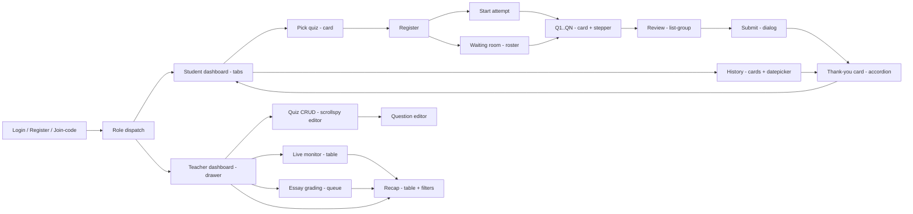

# Prototype Interaction — quiz-v2 (Bootstrap full + inline CSS only)

Status: DRAFT | Owner: 04-FRONTEND | Updated: 2026-10-14 (Q10/Q12 applied: history route cross-referenced to API-039b `GET /attempts/history`; `docs/DESIGN.md` marked NON-authoritative per UI-009; banner copy verified identical to F-002/DEC-102 across ERR-502, fallback, and this file)

Navigation, routes, and layout shell with EXACT Bootstrap bindings. Behaviour
(guards, deep-links, transitions) unchanged from R2 except the DEC-104/110/112/113/115/119/120/121/123/124/125
alignments noted inline; this revision binds the
shell to `navbar`/`drawer`/`navs-tabs`/`breadcrumb`/`menu` and the layout to
`container`/`grid` per `01-DESIGN-SYSTEM.md` §§3–4. Inline `style=""` follows
the closed property list there; no `<style>` blocks, no custom stylesheets. Full jQuery
(UI-002, DEC-114); native-only SSE/`EventSource`, `sendBeacon`, SPA/router.

## 1. Route inventory (SSR pages; actions are POSTs defined in §2 of this file)

| Route | Actor | Purpose | Guard | Bootstrap shell |
|-------|-------|---------|-------|-----------------|
| `GET /login`, `GET /register`, `GET /join?code=` (+ identify) | public | Auth + token entry | Redirect `/` if logged in | `examples/sign-in` centred `card` + `floating-labels` + `validation` + `password-strength` (register) + `otp-input` code boxes (`/join`) |
| `GET /` | router | Role dispatch → `/student` or `/teacher` | Auth | Redirect only (no render) |
| `GET /student` | student | Overview dashboard (analytics + 3 tab sections, full list DEC-113) | student | `navbar` + `navs-tabs` (Dibuka › Terdaftar › Ditutup) + stat `card` row + quiz `card`s + `button-group` window filter (SSR GET, DEC-112) + one-time `carousel` onboarding |
| `GET /student/history` (served by API-039b `GET /attempts/history`) | student | Attempt history cards → receipt links (keeps query-box + chunked browsing) | student | `card` list + `datepicker` day filter + `input-group` search (`?q` AJAX fragment + `replaceState`-only, others SSR GET per DEC-112; `?q/&date/&page`, SSR default 25, BR-055) + `pagination` |
| `GET /student/profile` | student | Edit email/name/class/grade/password | student | `card` form + `floating-labels` + `combobox` class/grade + `validation` |
| `GET /attempts/:id/questions/:n` | student/anon-token | One-question page; closed quiz renders the sudah-ditutup 200 view (DEC-115) | attempt member | `card` + `progress` + `stepper` text + `role=timer` countdown (freezes on dead stream, DEC-125) + `list-group` options (`radio`/`checkbox`/`form-control` essay) + sticky bottom `navbar` bar (`btn-lg`, inline safe-area) |
| `GET /attempts/:id/review` | student/anon-token | Review (total/none; read-only trail per-Q); closed quiz renders the sudah-ditutup 200 view (DEC-115) | attempt member | `card` + `list-group` rows with `badge` + `chips` + sticky `navbar` submit → `dialog` confirm |
| `GET /attempts/:id/result` | student/anon-token | Thank-you card per visibility flags; temporary → final only on refresh/reopen (DEC-104) | submitted | `card` + score `badge`s + `accordion` breakdown + `progress` summary + print `button` |
| `GET /matching/:id/waiting` | student/anon-token | Waiting room + SSE; leave via `POST /matching/:id/leave` pre-start (DEC-121) | registered | `card` + `avatar` `list-group` roster + count `badge` + `progress` + `alert-info` + leave `button` |
| `GET /teacher` | teacher | Overview (school analytics) | teacher | `navbar` + `drawer` sidebar (lg) + stat `card` row + pending-essay `badge` + shortcuts + Daily Pulse rail (`card`: deep-blue `brand-900` heading, today's counts, live session state, at most one `accent-100` reminder with text link — API-070; visual reference `docs/DESIGN.md` §4.4, NON-authoritative per UI-009) |
| `GET /teacher/quizzes` + `/new`, `/:id/edit` | teacher | Quiz CRUD + question editor (keeps query-box) | owner (DEC-031) | `drawer` shell + `breadcrumb` + status filter + `input-group` search (`?q` AJAX fragment + `replaceState`-only, others SSR GET per DEC-112; `?status/&q/&page`, SSR default 25, BR-055) + `pagination` + `card` forms (`switch`, `range` + number mirror, `input-group`) + `scrollspy` section nav on long editor + per-question `collapse` fieldsets |
| `GET /teacher/matching/:id` | teacher | Waiting roster surface + controls + SSE (surface 1 of DEC-110) | owner | `card` roster + control `button-group` (each → `dialog`) + `toast` stack + SSE binding (roster/presence `occupant_progress`, DEC-119/120) |
| `GET /teacher/monitor/:quizId` | teacher | Live progress surface + SSE (surface 2 of DEC-110; normal & matching) | owner | `container-fluid` + `table-responsive` `table` (sticky header, frozen name col) + row `collapse` on phone + `stale` `alert-warning` + `menu` row actions (revoke pre-start) + SSE binding (progress/cheat via `occupant_progress`, DEC-119/120) |
| `GET /teacher/quizzes/:id/grading` | teacher | Essay queue | owner | `breadcrumb` + `list-group`/`table` rows (`avatar`, `prose`, `input-group` grade + `/10` adorn) + `pagination` + `alert-success` empty state |
| `GET /teacher/quizzes/:id/recap` | teacher | Recap table + XLSX export | owner | `container-fluid` + filter bar (`button-group` window + `datepicker` + `combobox` class + `input-group` search: `?q` AJAX fragment + `replaceState`-only, others SSR GET per DEC-112, BR-055) + `table-responsive` + `pagination` (SSR default 25) + one-click `recap.xlsx` export `button` (API-063) |
| `GET /teacher/users`, `/teacher/profile` | teacher | User mgmt + own profile (keeps query-box) | teacher | `drawer` shell + `input-group` search (`?q` AJAX fragment + `replaceState`-only per DEC-112; `?q/&page`, SSR default 25, BR-055) + `pagination` + `table` (users, row `menu` actions) + `card` profile form + button `dialog` deletes (no typed text, DEC-042) |
| `GET /change-password` | forced | Seed rotation gate | must_change flag | `sign-in` `card` only + `password-strength` + `validation` |
| `GET /uploads/:ref` | signed | Image bytes (NOT public static) | quiz access | No page (bytes; `.img-fluid` at render sites) |

Every route has a reason; no dead ends: every terminal view links onward
(result → dashboard/history; recap → grading; empty states → creation).

## 2. Navigation graph

Shell rules: student = top `navbar` only (linear flow, no `drawer`, no
`breadcrumb`); teacher = `navbar` + `drawer` + `breadcrumb` on management
pages; `menu` overflow never the only path to an action. `nav-overflow`
scrollable tab bars on phone for dashboard tabs.

Back/cancel/close: back during answering = safe (answers server-saved);
back on review = returns to questions; waiting-room leave pre-start navigates
only after `POST /matching/:id/leave` succeeds (DEC-121) — closing the tab
without leaving keeps `last_seen` server-side and rejoins on return; pause
blocker has no close path by design. Unsaved-change guard, two layers
(DEC-123): native `beforeunload` only while `saving` is in flight; dirty-flag
dialog (Bootstrap `dialog` on the dirty-essay flag, typed but unsaved essay
text) — after successful save no confirm. `replaceState`-only search updates (DEC-112) do
not add history entries; the server GET is the filter restore path.

## 3. Guards and failure navigation (Bootstrap renderings)

- Unauthenticated → `302 /login?next=...` preserving destination
  (`sign-in` card with `alert-info` "masuk untuk melanjutkan").
- Forbidden (role) → `card` 403 page with dashboard link (no redirect loop).
- Hidden student access → `card` 404 ("tidak ditemukan") per BR-007; closed
  quiz attempt/review routes render the sudah-ditutup 200 closed view (DEC-115).
  EDGE-068 trace: BR-007 + DEC-115 + AC-226.
- Submitted attempt question URLs → `alert-warning` 410 + receipt link (EDGE-025).
- Self-register success → `303 /login` with no session (DEC-087, `registered-no-session`).
- Deactivate blocked (live open-quiz rows) → 409 ERR-115 page (DEC-081).
- Delete-last question of an open quiz → 422 ERR-108 (DEC-089, close first).
- Exhausted start on a stranded row → 410 ERR-208 + row auto-cancelled (DEC-083).
- Late submit (timer already auto-submitted) → result card with the auto-submitted
  receipt, success framing (DEC-086, never an error).
- Same-verb re-click within 10 s (stale version) → 429 inline warning + current
  state (DEC-085, refined R8).
- Close/hide while `waiting` → room closes (`room_closed`, DEC-093/094);
  close/hide while `running`/`paused` → 409 "hentikan sesi dulu".
- Offline-lost answers → banner states exactly what was dropped (DEC-090).
- Expired session mid-flow → login, then resume at server position
  (EDGE-060); draft kept client-side where applicable. Expired/idle wording
  stays success-framed on the result path (DEC-086).
- No-JS banner lists exactly three unavailable items (cheat detection, SSE
  push, toasts) per EDGE-045/DEC-128.
- SSE drops → persistent inline `alert-warning` with the exact F-002 notice
  text ("Koneksi live terputus — jawaban tersimpan aman. Refresh halaman
  untuk menyambung ulang."), no navigation, no spinner, no auto-reconnect
  (DEC-102); user refresh rebuilds the page from server truth.
- Session `finished`/quiz closed → waiting room `alert-secondary` ended
  state + recap link (no join).

## 4. Deep-link, refresh, restart, expiry

- Refresh on Qn: re-renders same N from server snapshot (position/deadline
  authoritative); `progress`/`stepper` widths recomputed server-side inline.
- Refresh in waiting room: rejoins presence automatically (`connected=1`).
- Browser restart: login → dashboard "lanjutkan" `card` for `answering`
  attempts (server `current_index`); matching resume only if session still
  running/paused AND the occupant is ever-present (`answering`), else the
  auto-submitted receipt for present occupants or the no-show state for
  never-present rows (DEC-088 — never auto-submitted).
- Attempt-token links (anon): single-quiz deep links until 24 h token expiry
  (login sessions are separate: 60-min sliding idle, BR-054);
  expired → join page `alert-warning` "tautan kedaluwarsa, masukkan kode"
  with `otp-input` boxes ready.
- Login session expiry (60-min idle, BR-054): any POST → login with draft preserved where
  applicable; SSE closed; `toast` on next login "sesi sebelumnya berakhir".

## 5. Transitions (behavioural, Bootstrap-bound)

Full-page loads for auth/discovery/management; jQuery-AJAX partial saves on
question pages (`jQuery.ajax` per UI-002, DEC-114; progressive enhancement,
`spinner` + `toast`); NATIVE-`EventSource` SSE-driven
auto-navigation for start/pause/stop/expire events only (graded refresh
rule: temporary → final only on refresh/reopen per DEC-104; announced
via live region before moving focus). Expired total-timer navigations land on
the result card with the auto-submitted receipt (success framing per DEC-086).
Uncommitted answers lost to offline are reported dropped (DEC-090) — the client
never claims them saved. No client router, no history-API
tricks beyond `replaceState`-only search fragments (DEC-112): URLs always
reflect server state so refresh/share behave; the server GET is the filter
restore path.
`prefers-reduced-motion` respected everywhere (`carousel` still, `progress`
static, `toast` instant, `placeholder` static). Onboarding `carousel` is the
only auto-advance candidate and it does NOT autoplay in MVP.

UI-owned audit notes (S1..S6, one-liners):
- S1/S2/S3/S5/S6: not UI-owned — no UI decision recorded here.
- S4-heartbeat (CLOSED, DECIDED S4a 2026-10-14): payload is `{server_now_utc}`, emitted every 30 s; the single stale threshold is 60 s — after 60 s without a heartbeat the stale banner shows, numbers stay frozen at the last-seen value and the spinner is cleared (§1 monitor rows, §5 transitions, C-006/C-010). The separate dead-stream silence timeout (45 s, DEC-102) is a different mechanism and is unchanged.
- Accepted limitation (not a decision): abort-toast wording, focus return, and live-region polish stay best-effort per C-010/§5.
