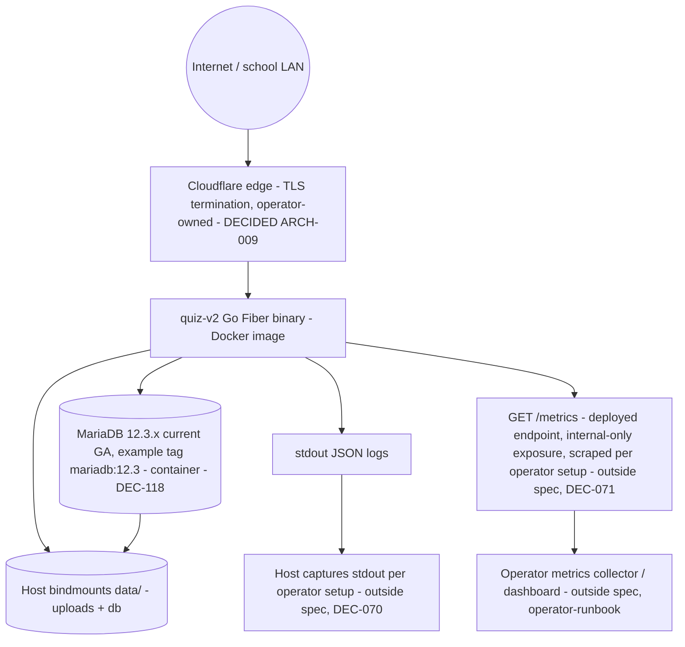

# Infra Topology — quiz-v2

Status: DRAFT | Owner: 05-DEVOPS | Updated: 2026-10-14 (ARCH-009 applied: **NGINX REMOVED** — the `app` container is exposed to the internet through Cloudflare directly, TLS terminates at Cloudflare, HTTP response caching is owned by Go Fiber per ARCH §8; ENV-01 answers the eliminated-component questions, ENV-02 records the accepted SSE risk)

## 0. Scope

Single-school, single-host Docker Compose deployment (DECIDED stack). No
Kubernetes, VPC design, replicas, CDN, or multi-region — explicitly NOT
APPLICABLE with reasons (per the skill's §2.8 rule: retain the file with a
concrete reason instead of inventing requirements): unvalidated scale, single process holding
in-memory SSE/timers by design (ARCH-004).
**Correction 2026-10-14 (ARCH-009):** the single edge component in front of the
host is now **Cloudflare** — a CDN, arriving with the user's decision to drop
NGINX. It is used for TLS termination, DNS and DDoS filtering ONLY. The scope
line's "No CDN" still holds in the sense that matters: no cached content, no
multi-region data residency, and no edge-cache tier is spec-asserted anywhere —
because every cacheable response class in ARCH §8 is `private` or `no-store`,
an edge must not and cannot cache it.

## 1. Topology

| Element | Purpose | Notes |
|---------|---------|-------|
| Cloudflare edge (DECIDED ARCH-009, 2026-10-14 — **supersedes DEC-022; NGINX is removed**) | TLS termination (`Full (strict)`, operator-owned origin certificate), public DNS, DDoS filtering | No NGINX exists in prod: the `app` container's published port is reachable only through Cloudflare, so the host MUST firewall all other inbound traffic to just Cloudflare's published ports (Cloudflare origin-IP rescue is the residual risk — operator-runbook). Cache behaviour at the edge is NOT relied upon by this spec: caching is origin-owned by Go Fiber (ARCH §8) and every cacheable class here is marked `private`/`no-store` so an edge cannot legally cache it. TLS version/cert specifics are operator-runbook (deferred, Q11). Dev bypasses the edge entirely (app serves HTTP on its own dev port — §3). |
| `app` container | Go Fiber binary + templates + static (incl. vendored Bootstrap CSS/JS pair + jQuery 4.0.0 `/static/jquery/` + Gotham Rounded fonts, no build step); runs migrations at boot, then serves | Single instance; restart policy `unless-stopped`; Docker healthcheck `GET /healthz` (liveness only — process up); deploy/edge/smoke gate is `GET /readyz` (migrated + DB ping + volume writable) per the observability contract (N7); **owns every HTTP response header including Cache-Control/ETag/Last-Modified and gzip compression (ARCH §8)**; `/metrics` is bound to an internal interface only and never published (no proxy hides it anymore — ARCH-009); persistent data via host bindmounts only (see `data/` below — never baked into the image) |
| `db` container | MariaDB 12.3.x current GA (example tag `mariadb:12.3`, DEC-118), internal port only (never published) | Port convention: the container exposes the MariaDB default `3306` on `quiznet` only; nothing is published to the host (no `ports:` entry in the Compose file), so `DB_HOST` is the Compose service name and `DB_PORT` is `3306`. Credentials via env file, never baked into image; datadir via host bindmount (see `data/` below) |
| Host bindmounts (`data/`, DECIDED R9 2026-10-12 — replaces named volumes; container paths per ARCH-006; the capacity envelope these bindmounts live inside is ARCH §6 — see §4 below) | `data/uploads/` → `/data/uploads` (images), `data/db/` → `/var/lib/mysql` (datadir) | `data/` is gitignored and never copied into the image (`.gitignore` + `.dockerignore`); dev: `./data/` in repo root; prod: any host dir (e.g. `/opt/quiz-v2/`); backup unit = both host dirs + env file inventory (not secrets content) |
| Backup | DEFERRED per user 2026-10-14 (DEC-050 skipped): operator-owned dumps/snapshots; no schedule/retention/RTO/RPO asserted by this spec | Restore drill: an operator-runbook pre-go-live responsibility — the operator defines the drill and records its outcome at deploy time. This spec mandates no drill, no schedule, and no verifying stage (no RTO/RPO value exists in the spec to drill against). See the deferral register, §6. |

Environments: `dev` (Compose on teacher laptop/server, HTTP — the proxy is
bypassed, so the app publishes its own dev port; see §3/F-25) and `prod`
(single school server, HTTPS via proxy). No staging in MVP (reason: same
Compose file with env overrides; staging without traffic adds no signal) —
revisit only on a validated requirement.

## 2. Configuration and secrets

Env-only config (`APP_ENV`, `APP_BASE_URL`, `SESSION_SECRET` (32B+), `DB_*`
incl. `DB_HOST` = the Compose service name and `DB_PORT` = `3306` per the `db`
port convention in §1 — internal only, never published),
`SEED_TEACHER_EMAIL/PASSWORD`, `UPLOAD_DIR`, `PROXY_*`). Secrets via host env
file `0600`, never committed, never logged. `SESSION_SECRET` rotation =
invalidate all sessions (documented effect). Rotation CADENCE is not pinned by
this spec — a rotation period for any secret is an operator-runbook item (see
the deferral register, §6; the effect of a rotation is specified, the timing
is not). Seed consumes and never stores the plaintext password (bcrypt only).

## 3. Networking and boundaries

Single Docker network `quiznet`. Only the `app` container publishes ports, and
it is reachable in prod **only through Cloudflare** (ARCH-009): the published
port must be firewalled at the host so that direct-to-origin traffic is
refused, and the host must not publish `3306` or `8080` otherwise. Prod is
HTTPS at Cloudflare, so `Secure` cookies and `EventSource` both work. Dev
bypasses the edge entirely and publishes a single app HTTP port bound to the
local host only (loopback/localhost, never `0.0.0.0`) — the app's `/readyz`
endpoint is therefore reachable for the dev deploy gate on that port, and the dev
URL is HTTP rather than HTTPS. DB is never published in either environment
(internal `3306` on `quiznet` only). ENV-01: with NGINX gone, `proxy_buffering
off` and the ≥90 s HTTP/1.1 keepalive do NOT exist as asserted behaviours and
are explicitly withdrawn — the F-002 dead-stream notice + user refresh
(DEC-102) is the ONLY SSE recovery, and no poll fallback is asserted. The
accepted, recorded risk (user decision "cukat catat risiko", ENV-02): Cloudflare
terminates long-lived connections, so an SSE stream can be dropped mid-exam;
the client's reconnect + DEC-102 refresh rebuild is the mitigation, and no rate
limit or retry policy is invented here. `/metrics` is no longer hidden by a
proxy: it is bound to an internal interface only, never published.

Edge config artifact expectation (revises F-26 — same "no config file shipped"
rule, new component, as clarified by ARCH-009): this suite ships NO Cloudflare
configuration artifact and pins no cloud-side rule values. The artifact itself
(TLS mode, cache rules, page rules) is operator-runbook; what this spec DOES
assert about the deployment is — TLS termination at the edge, the host firewall
refusing non-Cloudflare inbound traffic, and that no edge caching is relied upon
(ARCH §8 classes are `private`/`no-store`) — everything else is the operator's
at deploy time (see INFRA §6). HTTP response caching and compression live in Go
Fiber (ARCH §8), not here.

## 4. Scaling, availability, recovery

- Scaling: vertical only (capacity envelope in ARCH §6 — ≤500 users, ≤100
  concurrent SSE streams, ≤10 parallel timed sessions, fan-out <2 s DEC-023).
  Overload → 503 with backoff (F-001); no autoscale.
- Availability: single-host; expected downtime = host reboot + image pull.
  RTO/RPO and the hardware floor are DEFERRED per user 2026-10-14
  (DEC-052/053 skipped): no RTO/RPO numbers or hardware minimum asserted by
  this spec; the operator records them at deploy time (see the deferral
  register, §6).
- Recovery: `docker compose up -d` recreates app; boot reapplies migrations
  (idempotent) + timer sweep (F-003); uploads reattached by the host bindmount
  (`data/uploads/` → `/data/uploads`).
- Deploy-fail serving accuracy (F-61, same contract as CICD §3, restated so the
  two files agree): `docker compose up -d` stops the old container BEFORE
  starting the new one, so a deploy that fails the smoke gate briefly serves
  nothing — the observable is a short outage (rollback blip), NOT continued
  serving of the previous version. The smoke gate is the only thing that turns
  a failed deploy into a rollback instead of a live outage.
- Data loss boundaries: committed DB rows durable; in-flight unsent answers
  (client queue) lost on browser close (EDGE-031 — relogin resolves via the
  idempotency key; typed-but-unsent text lost with notice, EDGE-033); anonymous
  pre-start intents lost on restart (EDGE-051 — intent/presence lost,
  re-enter code+name, submitted attempts intact). Restart does not lose
  submitted rows or committed answers.

## 5. Operational constraints

Deploy-time: migrations run BEFORE serving (boot gate; `/readyz` 503 until
migrated + DB ping + volume writable — per the observability contract, N7) against
MariaDB 12.3.x current GA (example tag `mariadb:12.3`, DEC-118). `/healthz` is
liveness only (process up) and is NEVER used as a deploy, proxy, or smoke gate —
it is a Docker healthcheck signal, not a readiness signal. Migration-failure
boot semantics: a failed migration ABORTS the boot — the process exits with a
non-zero code and logs the failing migration id (no serve-stale, no retry loop
inside the container); recovery is an operator fix + `compose up -d` again, and
`/readyz` stays 503 meanwhile. `/metrics` is a deployed endpoint of the app
container with internal-only exposure (bound to the container/Compose network,
never published through NGINX) and is scraped by the operator's own collector —
the scrape target and the collector are operator-runbook items (§6), so the
series are produced and exposed even though collection is not mandated here.
Runtime: disk-full on uploads fails uploads only (quiz flow intact); disk-full
on DB fails writes (503 path). Clock: the server is the time authority
(`attempt_deadline_utc`/`submitted_at` are server-side; client clock irrelevant by
design) — host NTP is the operator-runbook responsibility that makes this true
(verification, cron and drift alerting are operator-runbook items, §6; this
spec asserts the requirement does not pin the NTP service or threshold).
Hardware floor: DEFERRED per user 2026-10-14 (DEC-053 skipped) — no minimum
asserted; the load shape is bounded by the ARCH §6 capacity envelope instead.

Links: architecture §ARCH-004/§6; fallback F-001..003; observability doc for
health/readiness/alerts (§3 is the authoritative readiness contract — INFRA and
CICD consume it, never redefine it).

## 6. Deferral register (operator-owned decisions — one consolidated list)

Everything below is deliberately deferred to the operator at deploy time per
the user decision recorded 2026-10-14 (00-INDEX.md §5e, Q11; the
DEC-052/053/060/061/062/071 family). **No value is asserted by this
specification suite**, and no "REQUIRED" gate in any DevOps file depends on
one of these values. Owner: the **operator** (the deploying
teacher/server administrator). Recording: each row is written into the
operator's own deploy runbook at deploy time; this spec deliberately does not
fix a format, a default, or an example, because any number written here would
be an invented decision rather than a recorded one.

| Deferred item | Family | Where this suite references it | Owner / recorded at |
|---|---|---|---|
| Backup schedule, retention, RTO, RPO, restore drill | DEC-050/052/053 | INFRA §1 Backup row, §4 Availability | Operator, at deploy time |
| Hardware floor (CPU/RAM/disk minimum) | DEC-053 | INFRA §4, §5 | Operator, at deploy time |
| Host metrics/dashboard collector and scrape target | DEC-071 | INFRA §5, observability §3 | Operator, at deploy time |
| Alert thresholds (host disk/mem + app ERROR-rate, ALL of them) and the accumulation window for each | DEC-071 | Observability §1 (DB disk-full), §3 | Operator, at deploy time |
| TLS version, cipher suite, certificate source and renewal | DEC-022 (TLS operator-owned, specifics deferred per Q11) — now terminating at the Cloudflare edge (ARCH-009) | INFRA §1 Cloudflare row, observability §5 | Operator, at deploy time |
| Base-image verification / image-scan stage | DEC-060 | CICD §1 Build row | Operator, as a runbook step (no new mandatory CI stage) |
| Deploy-access method (key custody, who may push to prod) and reviewer count for merge approval | DEC-061/062 | CICD §1 Deploy row, §3 | Operator, at deploy time |
| Secret rotation cadence | covered by the deferral principle | INFRA §2 | Operator, at deploy time |
| Host NTP service configuration and verification method | covered by the deferral principle | INFRA §5 | Operator, at deploy time |

Rules that apply to the whole register: (a) the deferral is a decision, not a
gap — a value absent from this suite must be read as "operator decides", never
as "unspecified bug"; (b) if the operator later fixes a value, it lives in the
operator's runbook, and this suite is not edited to pin it; (c) the deferral
never downgrades a readiness/health gate — those are stated exactly in
observability §3 and are not deferrals.
