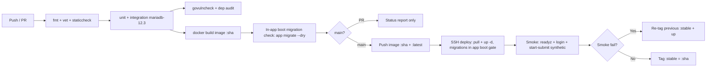

# CI/CD Spec — quiz-v2

Status: DRAFT | Owner: 05-DEVOPS | Updated: 2026-10-14

Deferral note (Q11, user decision 2026-10-14): scanner set, base-image
verification, deploy-access method, reviewer count and alert thresholds are
deliberately deferred to the operator at deploy time; they are consolidated
once in the deferral register at `01-INFRA-TOPOLOGY.md` §6, which this file
cites instead of repeating.

## 0. Scope

Single-branch trunk (`main`) + short-lived feature branches. No release
trains, canary, or blue-green in MVP (reason: single host, single school,
instant rollback = previous image tag). SAST tooling: `go vet` +
staticcheck (Lint stage) + `govulncheck` and a dependency audit (Security
stage) are REQUIRED and are implemented by the Lint/Security stages below.
There is deliberately NO DAST stage in this pipeline (no runtime target exists
in the MVP deploy model); dynamic testing, heavier scanners, review rules, and
deploy-access details are DEFERRED per user 2026-10-14
(DEC-060/061/062 skipped) and are listed in the deferral register
(`01-INFRA-TOPOLOGY.md` §6). Owner: operator, at deploy time.

## 1. Pipeline

Stages, gates, owners:

| Stage | Checks (all REQUIRED unless marked) | Gate |
|-------|--------------------------------------|------|
| Lint | `gofmt -l`, `go vet`, staticcheck (required where configured) | Fail blocks merge |
| UI conformance | AC-217 grep (vendored `<script src>` allow-list only: `bootstrap.bundle.min.js` + `jquery-4.0.0.min.js`, no CDN, no other local JS; single `@font-face`-only `<style>`; only 2 vendored CSS links; `style=""` closed property list incl. UI-007 hex + UI-006 font stack — DEC-114) + AC-218 mapping check (every USED §4 row referenced in templates) | Fail blocks merge |
| Test | `go test ./...` incl. race for services; integration vs MariaDB 12.3.x current GA service (example tag `mariadb:12.3`, DEC-118: transactional grading, timer sweep, SSE delivery + dead-stream notice/refresh, XLSX export AC-219) | Coverage gates: ≥85% overall AND 100% on critical paths (DEC-001: grading, timers, submit idempotency, auth/session, RBAC, matching verbs — asserted by AC-101/109/110/112/115/123/134/154/156/203/208/210); race failure blocks |
| Security | `govulncheck`, `go list -m` audit | HIGH vuln blocks |
| Build | Multi-stage Dockerfile (builder → minimal runtime base); image `:sha` | Reproducible (no `latest` writes mid-PR). Base-image verification: NO claim is made here that the base is verified or scanned by this pipeline — base-image provenance/verification is an operator-runbook step (deferred, DEC-060 family; see the deferral register in `01-INFRA-TOPOLOGY.md` §6), so no "distroless" or "hardened" property is asserted. |
| Migration check | In-app boot subcommand `<binary> migrate --dry` (the same code path that applies numbered SQL migrations at boot — no standalone migrate CLI exists and none is built; ERD §8) against ephemeral MariaDB 12.3.x current GA (example tag `mariadb:12.3`, DEC-118); destructive ops (`DROP`) fail the check unless allow-listed | Fail blocks |
| Deploy (main only) | SSH with deploy key; `compose pull && compose up -d`; migrations run in app boot gate (abort boot on migration failure — see INFRA §5) | Manual approval REQUIRED for prod, automatic for dev. The approval BUTTON's key custody, the deploy-access method and the reviewer count are operator-runbook items (deferred, DEC-061/062; see `01-INFRA-TOPOLOGY.md` §6) — owner: operator, at deploy time. |
| Smoke | `/readyz` (migrated + DB ping + volume writable — the deploy/proxy/smoke gate per the observability contract, N7; `/healthz` is liveness only and is NOT a deploy gate), seeded-teacher login, synthetic quiz start→answer→submit→recap in <60 s | Fail → auto rollback to `:stable` |
| Rollback | Re-tag + up; migrations are forward-only (rollback = code revert + compensating migration, never `migrate down` on prod data) | Owner: releaser |

Secrets in CI: deploy key + registry creds as CI secrets; never echo.
Artifacts: image `:sha` (+`:stable` pointer), migration bundle hash, smoke
log, coverage report (overall + critical-path files). Branch rules: linear
history (squash). Reviewer count and deploy-access method are operator-runbook
items (DEC-061/062 skipped, not asserted here — owner: operator, at deploy
time; see the deferral register in `01-INFRA-TOPOLOGY.md` §6, which is the one
consolidated list for the whole folder).

## 2. Migration ordering and compatibility

Expand-first: additive migrations deploy freely; destructive changes ship as
additive + backfill + deferred drop across two releases. Old code never runs
against new-required columns (deploy = migrate-then-serve same image).
Rollback never reverses a committed migration on prod data.

## 3. Failure behaviour

Lint/test fail → PR blocked with log link. Build fail → no tag. Deploy fail
→ the old container has already stopped (`up -d` stops old before starting
new), so a smoke failure leaves the rollback blip (short outage) — the old
image is re-tagged `:stable` and re-launched, see the corrected contract
below. Smoke fail → auto rollback + alert. Notification: CI summary + deploy
log file; chat hooks NOT APPLICABLE (no channel supplied). Scanner set, base
image verification, review rule, and deploy-access method are operator-runbook
concerns (DEC-060/061/062 skipped per user 2026-10-14 — deferral register:
`01-INFRA-TOPOLOGY.md` §6; the same contract is restated in INFRA §4).

Deploy-fail serving accuracy (S6b, corrected): the earlier "Compose replaces
only on success" sentence is factually wrong — `docker compose up -d` stops the
old container before starting the new one, so a deploy that fails the smoke gate
briefly serves nothing (the old image is not kept running). The corrected
contract: deploy = pull + `up -d` (new container starts, old stops; the new
container applies migrations in its app boot gate before serving); smoke runs
against the new container; smoke PASS → tag `:stable` = `:sha`;
smoke FAIL → re-tag previous `:stable` + `up` (rollback blip). The expected
observable during a failed deploy is therefore a short outage, not continued
serving of the previous version — the smoke gate is the only thing that turns a
failed deploy into a rollback instead of a live outage.

## 4. DECISIONS (resolved 2026-10-14 per §5b; S6 trio closed)

The S6 trio is closed below; the pipeline gates are unchanged by these decisions
(DEC-001 gates stay enforced — see S6c).

- **S6a — Integration DB: RESOLVED.** CI runs integration tests against the
  MariaDB 12.3.x current GA service (example tag `mariadb:12.3`, DEC-118) — the
  same image as prod, so the CI DB is the prod DB shape. Local dev runs are
  allowed to use sqlite for speed/convenience, but this is a **divergence**, not
  an equivalence: anything that passes on sqlite and fails on MariaDB is a real
  defect, and the CI MariaDB run is the authority. A divergence runbook (which
  checks are sqlite-only, which are MariaDB-authoritative, what to do on
  mismatch) is recorded at deploy time by the operator — it is not asserted by
  this spec beyond "CI MariaDB is the gate".
- **S6b — Deploy-fail serving claim: RESOLVED (corrected).** The corrected
  contract is in §3 (Deploy-fail serving accuracy): `up -d` stops the old
  container before starting the new one, so a failed smoke run produces a
  rollback blip (short outage), not continued serving of the previous version.
- **S6c — 100%-critical-coverage waiver process: RESOLVED — no waiver.** DEC-001
  gates (≥85% overall AND 100% on critical paths: grading, timers, submit
  idempotency, auth/session, RBAC, matching verbs) stay enforced with **no waiver
  path**. There is no process by which a critical-path gap may ship; a failing
  critical-path coverage gate blocks the release. The gate list is fixed
  (AC-101/109/110/112/115/123/134/154/156/203/208/210); adding a path to the
  critical set is a spec change, not a waiver.

Deferral note (Q11, recorded 2026-10-14): the CI-side items the operator owns —
scanner set, base-image verification, deploy-access method, reviewer count —
are consolidated once in `01-INFRA-TOPOLOGY.md` §6 and are operator-runbook
responsibilities at deploy time. This spec does not pin any of their values,
and no stage in the table above becomes conditional on them.

Endpoint references used by the pipeline (owned by observability §3, cited
only): `/healthz` = liveness (Docker healthcheck signal only, never a deploy
gate), `/readyz` = the deploy/proxy/CI smoke gate, `/metrics` = a deployed
internal-only endpoint the app exposes (operator-runbook collector scrapes it;
the pipeline does not assert a scrape). No consumer-facing contract for these
three is written in the API spec, so they are referenced here as infra
contracts only.

Cross-refs (owned elsewhere, cited only): S1 Retry-After header is server-owned (see business/API error handling); S3 ERR-116 restart behaviour is in-memory accepted per single-process design; S4 heartbeat shape is API-owned (see API SSE contract).
