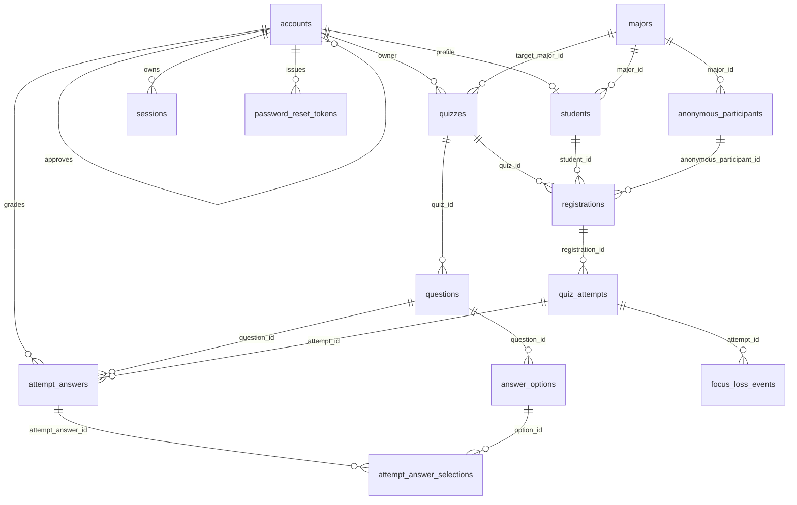

# Schema and Migrations — Design

**Date:** 2026-10-23
**Status:** approved
**Scope:** database schema and migration mechanics only. No handlers, repositories, templates, or other application logic.
**Supersedes:** §11 ("Data model") of `2026-10-20-quiz-system-design.md`. That section is retained for history and must not be implemented against.

---

## 1. Intent

Give `quiz-v2` a database that the UI can be built against without further modelling
guesses: every entity the screens assume, every attribute they render, and no attribute
that would force a handler to invent one later.

The schema is **greenfield**. The v1 database at `D:\Project\Mother\quiz` is reference
material only — no tables, names, enum literals, or score scales are inherited, and no
data is migrated.

## 2. Goals

- One school, one MariaDB instance on the same host as the app. Low hundreds of thousands
  of rows at worst — `attempt_answer_selections` dominates — and the whole dataset still
  fits in a sensibly sized buffer pool.
- Every table carries the full audit kit, so no screen waits on a column.
- Types are narrow and enforced by the schema (`NOT NULL`, `CHECK`, exact length,
  matching reference widths), not by convention.
- Storage and per-row CPU stay proportionate: no `BIGINT` keys, no `JSON`, no `TEXT`
  where a bounded `VARCHAR` is correct, no redundant indexes.
- Migrations are trivial to apply and reason about: numbered, forward-only, idempotent,
  stopped-app acceptable.
- Deletion is reversible and consistent: soft everywhere, cascading down the graph,
  one timestamp per event.

## 3. Non-goals

- Multi-tenancy, sharding, partitioning, read replicas.
- Zero-downtime DDL, expand/contract, shadow tables.
- Down-migrations. Rollback is "restore the backup"; see §9.6.
- Query layer, ORM, repositories, purge jobs, fixture→row loading. The existing fixture
  world is replaced by compliant data in a later task (see §3.1).
- Backfilling v1 data.

### 3.1 Known follow-on work created by this document

The current fixture world violates the private-quiz audience rule (a grade-11 student
registered in a grade-XII quiz), models anonymous identity per registration rather than
per person, and represents "no audience" as `0` where the schema now requires `NULL`. All
three are corrected at the schema level, which means the fixtures must be rebuilt to match.
That is a separate piece of work with its own plan.

## 4. Anti-goals

Things that make this design a failure even if every table exists:

- A duplicate account, because uniqueness was expressed with a nullable column (§5.3).
- A soft-deleted row that reappears, or a live row that vanishes, because `deleted_at`
  means two different things in two places.
- A score stored 0–100 in one table and 0–1 in another.
- A cascade that half-completes, leaving a student visible but their attempts orphaned.
- A schema so micro-optimised that a builder cannot tell what a column is for.

## 5. Conventions

### 5.1 Engine, charset, collation

| Level | Setting | Why |
|---|---|---|
| Engine | `InnoDB` | FKs, transactions, clustered PK. |
| Database default | `utf8mb4` / `utf8mb4_unicode_ci` | Indonesian text, emoji-safe, predictable sorts. |
| Human text | inherit | Name, title, body, feedback. |
| Machine strings | `CHARACTER SET ascii COLLATE ascii_bin` | Codes, tokens, enum columns, hashes. 1 byte/char, no collation weight table, exact compare. |

Exception: `email` uses `ascii_general_ci`, because case-insensitive uniqueness is the
correct behaviour and avoids forcing normalisation before every insert.

### 5.2 The column kit

Every table, `schema_migrations` included, has:

| Column | Type | Null | Default | Note |
|---|---|---|---|---|
| `id` | `INT UNSIGNED` | NOT NULL | AUTO_INCREMENT | Primary key; the required clustered index. |
| `created_at` | `DATETIME` | NOT NULL | `CURRENT_TIMESTAMP` | UTC. |
| `updated_at` | `DATETIME` | NOT NULL | `CURRENT_TIMESTAMP ON UPDATE CURRENT_TIMESTAMP` | Native, no trigger. |
| `deleted_at` | `DATETIME` | NOT NULL | `'1970-01-01 00:00:00'` | **Sentinel, never NULL.** |

`id` is the clustered primary key. No second index is created on it — in InnoDB that
would be a duplicate B-tree and pure write amplification. The rule "index the id" is
satisfied by the primary key itself.

**Actor columns** are named after the role, not generically: `owner_account_id`,
`updated_by_account_id`, `graded_by_account_id`, `issued_by_account_id`. There is no
`created_by` — where a row has an owner, the owner *is* the creator.

**Delete provenance** is recorded only on the five tables a human can delete directly —
`accounts`, `anonymous_participants`, `quizzes`, `questions`, `majors` — via
`deleted_by_account_id INT UNSIGNED NULL`. Descendants inherit the cascade timestamp and
do not repeat the actor. One actor per delete event, stored at the root.

`deleted_by_account_id` has exactly two states: **NULL means the row was hidden by a
cascade or by the system** (expiry sweep, question reordering), and a value means **a
human deleted this row as the root of the event**. `questions` is both a root and a
cascade target, so without that rule the column is ambiguous on precisely the table where
provenance matters most.

### 5.3 The soft-delete rule (the one that bites)

`deleted_at` is **never NULL**. Live rows share the epoch sentinel; deleted rows hold a
real timestamp. That is what makes uniqueness work:

```sql
UNIQUE KEY uq_x (email, deleted_at)
```

With `deleted_at IS NULL` on live rows, MySQL and MariaDB treat every NULL as distinct,
so the key would never fire and duplicate emails would be accepted silently. The sentinel
gives all live rows the same value, so the key behaves as intended; deleting a row frees
the address for reuse.

Every read path filters `deleted_at = '1970-01-01 00:00:00'`. That predicate is a range
condition on an indexed column, not a function call, so it stays sargable. It is written
as a named constant in the query layer, not repeated as a literal.

No index is created on `deleted_at` alone: for reads it is a filter appended to a
composite key, not a leading key, and a separate B-tree per table would cost far more than
it saves. The one operation that reads it as a leading key is **restore** (§5.7), which
therefore scans. That is acceptable while restore is a rare, manual, whole-table event,
and the day restore gets a button is the day this index gets added.

### 5.4 Type policy

| Concept | Type | Enforcement |
|---|---|---|
| Boolean | `TINYINT(1) UNSIGNED` | `CHECK (col IN (0,1))`; `BOOLEAN` is only an alias |
| Normalised score | `DECIMAL(5,4)` | `CHECK (score BETWEEN 0 AND 1)`; 3 bytes, exact |
| Grade level | `TINYINT UNSIGNED` | `CHECK (grade_level BETWEEN 10 AND 12)` |
| Timestamp | `DATETIME` | 5 bytes, no per-row zone conversion, no 2038 cliff |
| Join code | `CHAR(6)` ascii_bin | `CHECK (code REGEXP '^[0-9]{6}$')` |
| Token / hash | `BINARY(32)` | raw SHA-256; half the bytes of hex, binary compare |
| Reference | `INT UNSIGNED` | must match the referenced PK exactly |
| Stable enum | native `ENUM` | 1 byte, integer compare |
| Growing enum | `VARCHAR(n)` ascii_bin + `CHECK` | adding a value is a `MODIFY`, not a rebuild |
| Bounded prose | `VARCHAR(n)` | in-row; no `TEXT` pointer |
| Unbounded prose | `TEXT` | essay answers and question prompts only |

Deliberately not used: `JSON`, triggers, stored procedures, `FLOAT`, `BIGINT` keys,
`TIMESTAMP`, generated columns.

### 5.5 Enum encoding

Stable → native `ENUM`: `accounts.role`, `accounts.status`, `quizzes.visibility`,
`quizzes.state`, `questions.type`.

Growing → `VARCHAR` + `CHECK`: `quizzes.review_mode` (three different value sets across
v1, the 2026-10-20 spec, and the fixtures) and `focus_loss_events.kind`.

`focus_loss_events.kind` vocabulary is fixed at:

| Value | Meaning |
|---|---|
| `blur` | window lost focus (another application took it) |
| `hidden` | document visibility became hidden (tab switch, minimise) |
| `fullscreen_exit` | the exam surface left fullscreen |

`other` is deliberately absent: an event the client cannot name is a client bug, and a
`CHECK` failure is the correct outcome.

### 5.6 Referential integrity

Real foreign keys with `ON DELETE RESTRICT ON UPDATE RESTRICT` on every relationship that
can have one. At this scale the check is one buffer-pool-resident index lookup; the cost
is unmeasurable and the alternative is silent orphaning.

**Every FK in this schema has a target.** The previous draft had one documented gap —
`sessions.user_id` was polymorphic across teachers and students. Introducing `accounts`
removes it: a session belongs to an account, and the role is read from the account.

Two enforcements remain impossible in pure DDL, both stated in §11:

1. An FK to `accounts` cannot assert `role = 'teacher'`. Every `*_account_id` that must be
   a teacher — `quizzes.owner_account_id`, `attempt_answers.graded_by_account_id`,
   `accounts.approved_by_account_id` — is app-validated.
2. A student account must own exactly one `students` profile. An FK proves the profile
   points at a real account; nothing proves the account has a profile. A student account
   without one is invisible to every roster query, so registration has to create both rows
   in one transaction.

Physical `DELETE` is never issued by normal operation. `RESTRICT` exists to make an
accidental hard delete fail loudly rather than remove a subtree.

### 5.7 Soft-delete cascade

Deleting a row soft-deletes everything reachable below it:

| Root | Cascades to |
|---|---|
| `accounts` | its `students` profile, `sessions`, `password_reset_tokens`; if a student, every `registrations` → `quiz_attempts` → `attempt_answers` → `attempt_answer_selections` and `focus_loss_events`; if a teacher, none of their quizzes' content |
| `anonymous_participants` | `registrations` → attempts → answers → selections |
| `quizzes` | `questions` → `answer_options`, and every `registrations` → attempts → answers → selections, plus those attempts' `focus_loss_events` |
| `questions` | `answer_options`, and `attempt_answers` for that question → their `attempt_answer_selections` |
| `majors` | **nothing — deletion is refused** while any live `students`, `anonymous_participants`, or `quizzes` row references it |

`majors` is the deliberate exception. Hiding a major that students and quizzes still point
at would strand them, and `RESTRICT` does not fire on a soft delete. So the app refuses the
delete, and the reference check **ignores soft-deleted children** — otherwise a major could
never be removed after the last of its students was deleted.

Rules:

- **One transaction.** A half-completed cascade is indistinguishable from corruption.
- **One timestamp.** Every row in a cascade receives the *same* `deleted_at` value, taken
  once at the start. That timestamp identifies the event, so restore is one predicate:
  `SET deleted_at = '1970-01-01' WHERE deleted_at = ?`.
- **Deepest-first is irrelevant; scoping is not.** Each statement is a set operation on
  a foreign key, not a row-by-row walk.
- **Restore can fail.** If the freed unique value (an email, a join code) was reused
  while the rows were deleted, restoring collides with the replacement. That must surface
  as an error on restore, never as a silent merge.
- **Teacher deletion does not cascade into their quizzes.** Deleting a teacher account
  hides the account and its sessions; the quizzes, questions, and results stay, because
  they belong to the students who took them. A quiz with an unreachable owner is a data
  state the app must render, not a schema problem. (If the product disagrees, this is the
  one cascade in the table that changes.)

### 5.8 Naming

Tables plural `snake_case`; columns singular; references `<entity>_id`; booleans read as
assertions (`show_score`, `allow_retake`); timestamps end in `_at`; constraints
`chk_<table>_<what>`, indexes `ix_<table>_<cols>`, unique keys `uq_<table>_<cols>`,
foreign keys `fk_<table>_<col>`.

---

## 6. Entity model

Fifteen tables: fourteen domain, one infrastructure.

### 6.1 `majors`

Reference table; read constantly, written rarely.

| Column | Type | Null | Default |
|---|---|---|---|
| `id` | `INT UNSIGNED` | NOT NULL | AI |
| `name` | `VARCHAR(50)` | NOT NULL | — |
| `code` | `VARCHAR(10)` ascii_bin | NOT NULL | — |
| `deleted_by_account_id` | `INT UNSIGNED` | NULL | — |

- `UNIQUE uq_majors_name (name, deleted_at)`
- `UNIQUE uq_majors_code (code, deleted_at)`
- `FK fk_majors_deleter (deleted_by_account_id) → accounts.id`

> Deletion is permitted only when no live student, anonymous participant, or quiz
> references the major (§5.7). It is the one root that cannot take its children with it,
> which is why it is also the one root whose cascade column is empty.

### 6.2 `accounts`

One row per human who can log in. This is the single home of the email address, and the
reason email uniqueness holds across roles.

| Column | Type | Null | Default | Note |
|---|---|---|---|---|
| `full_name` | `VARCHAR(100)` | NOT NULL | — | |
| `email` | `VARCHAR(254)` ascii_ci | NOT NULL | — | RFC 5321 ceiling; globally unique |
| `password_hash` | `VARCHAR(255)` ascii_bin | NOT NULL | — | bcrypt/argon2id |
| `role` | `ENUM('teacher','student')` | NOT NULL | — | `anonymous` is not an account |
| `status` | `ENUM('pending','active')` | NOT NULL | — | no default: a pending student is an invalid row |
| `approved_by_account_id` | `INT UNSIGNED` | NULL | — | teacher approval |
| `approved_at` | `DATETIME` | NULL | — | |
| `must_change_password` | `TINYINT(1) UNSIGNED` | NOT NULL | 0 | 1 for resets and bootstrap |
| `last_login_at` | `DATETIME` | NULL | — | written once per login, not per request |
| `deleted_by_account_id` | `INT UNSIGNED` | NULL | — | delete provenance |
| `avatar_name` | `VARCHAR(37)` ascii_bin | NULL | — | generated WebP name; `NULL` renders initials |

- `UNIQUE uq_accounts_email (email, deleted_at)` — the whole point of this table
- `UNIQUE uq_accounts_avatar (avatar_name, deleted_at)` — avatar serving; `NULL` means no photo
- `FK fk_accounts_approver (approved_by_account_id) → accounts.id`
- `FK fk_accounts_deleter (deleted_by_account_id) → accounts.id`
- `CHECK chk_accounts_student_active (role = 'teacher' OR status = 'active')`
- `CHECK chk_accounts_teacher_approval (role = 'student' OR (status = 'active') = (approved_at IS NOT NULL))`
- `INDEX ix_accounts_role (role, status)`

> `status` has no default on purpose. `DEFAULT 'pending'` would make the commonest insert
> in the system — a student registering — fail `chk_accounts_student_active`, and
> `DEFAULT 'active'` would quietly approve every teacher. Role and status are written
> together, or the insert fails.

> **Why there is no `teachers` table.** A teacher has no attribute that a student lacks;
> everything role-specific here is already shared. A student has two — grade and major —
> so `students` exists as a profile (§6.3). The asymmetry is deliberate: tables exist to
> hold attributes, not to mirror verbs.

> Deleting a teacher account does **not** delete their quizzes (§5.7). The account is
> hidden; the quizzes and their results remain attributable.

### 6.3 `students`

Profile rows for `role = 'student'` accounts.

| Column | Type | Null | Default |
|---|---|---|---|
| `account_id` | `INT UNSIGNED` | NOT NULL | — |
| `grade_level` | `TINYINT UNSIGNED` | NOT NULL | — |
| `major_id` | `INT UNSIGNED` | NOT NULL | — |

- `UNIQUE uq_students_account (account_id, deleted_at)`
- `FK fk_students_account (account_id) → accounts.id`, `FK fk_students_major (major_id) → majors.id`
- `CHECK chk_students_grade (grade_level BETWEEN 10 AND 12)`
- `INDEX ix_students_major (major_id, deleted_at)`, `INDEX ix_students_grade (grade_level)`

### 6.4 `anonymous_participants`

One row **per person**, not per quiz. Three registrations hang off one row.

| Column | Type | Null | Default | Note |
|---|---|---|---|---|
| `display_name` | `VARCHAR(100)` | NOT NULL | — | what they typed |
| `grade_level` | `TINYINT UNSIGNED` | NOT NULL | — | |
| `major_id` | `INT UNSIGNED` | NOT NULL | — | |
| `cookie_token_hash` | `BINARY(32)` | NOT NULL | — | SHA-256 of the identifying cookie |
| `last_seen_at` | `DATETIME` | NULL | — | refreshed on join |
| `deleted_by_account_id` | `INT UNSIGNED` | NULL | — | |

- `UNIQUE uq_anon_cookie (cookie_token_hash, deleted_at)`
- `FK fk_anon_major (major_id) → majors.id`, `FK fk_anon_deleter (deleted_by_account_id) → accounts.id`
- `CHECK chk_anon_grade (grade_level BETWEEN 10 AND 12)`
- `INDEX ix_anon_major (major_id, deleted_at)`

> Identity is the cookie hash, not the name. Two students called Budi in the same grade
> and major are two rows; the current `name|grade|major` grouping would have merged them.
> The teacher list becomes a plain read — no `GROUP BY`.
>
> Deleting an anonymous participant soft-deletes this row and cascades to their
> registrations and attempts (§5.7). Re-joining afterwards creates a new identity, because
> the sentinel rule frees the cookie hash — which is the correct reading of "forget this
> person".

### 6.5 `registrations`

One row per (quiz, participant). Participant is exactly one of a student profile or an
anonymous identity.

| Column | Type | Null | Default |
|---|---|---|---|
| `quiz_id` | `INT UNSIGNED` | NOT NULL | — |
| `student_id` | `INT UNSIGNED` | NULL | — |
| `anonymous_participant_id` | `INT UNSIGNED` | NULL | — |

- `CHECK chk_reg_participant ((student_id IS NULL) <> (anonymous_participant_id IS NULL))`
- `UNIQUE uq_reg_student (quiz_id, student_id, deleted_at)`
- `UNIQUE uq_reg_anon (quiz_id, anonymous_participant_id, deleted_at)`
- `FK fk_reg_quiz (quiz_id) → quizzes.id`, `FK fk_reg_student (student_id) → students.id`,
  `FK fk_reg_anon (anonymous_participant_id) → anonymous_participants.id`
- `INDEX ix_reg_quiz (quiz_id, deleted_at)`, `INDEX ix_reg_student (student_id, deleted_at)`,
  `INDEX ix_reg_anon (anonymous_participant_id, deleted_at)`

> Two unique keys, not one. A single `UNIQUE(quiz_id, student_id, anonymous_participant_id)`
> never fires for anonymous rows, because `student_id` is NULL there and NULLs never
> collide. Splitting the key per participant type works because the irrelevant column is
> NULL — the key simply does not apply to rows where its column is NULL. This is the one
> place the NULL-distinct rule is used deliberately rather than worked around.

### 6.6 `quizzes`

| Column | Type | Null | Default | Note |
|---|---|---|---|---|
| `owner_account_id` | `INT UNSIGNED` | NOT NULL | — | author and owner |
| `updated_by_account_id` | `INT UNSIGNED` | NULL | — | last editor |
| `title` | `VARCHAR(150)` | NOT NULL | — | longest fixture 31 |
| `description` | `VARCHAR(1000)` | NOT NULL | `''` | longest fixture 77; in-row |
| `visibility` | `ENUM('public','private')` | NOT NULL | `'private'` | |
| `state` | `ENUM('draft','open','closed')` | NOT NULL | `'draft'` | manual only; dates never change it |
| `code` | `CHAR(6)` ascii_bin | NULL | — | public only |
| `invite_token` | `VARCHAR(32)` ascii_bin | NOT NULL | — | every quiz, resolvable while draft |
| `target_grade` | `TINYINT UNSIGNED` | NULL | — | private only |
| `target_major_id` | `INT UNSIGNED` | NULL | — | private only |
| `starts_at` | `DATETIME` | NULL | — | display only |
| `ends_at` | `DATETIME` | NULL | — | display only |
| `allow_retake` | `TINYINT(1) UNSIGNED` | NOT NULL | 0 | |
| `max_attempts` | `TINYINT UNSIGNED` | NOT NULL | 1 | `0` means unlimited |
| `show_score` | `TINYINT(1) UNSIGNED` | NOT NULL | 1 | |
| `review_mode` | `VARCHAR(20)` ascii_bin | NOT NULL | `'questions_no_answers'` | growing vocabulary |
| `randomize_questions` | `TINYINT(1) UNSIGNED` | NOT NULL | 0 | |
| `randomize_options` | `TINYINT(1) UNSIGNED` | NOT NULL | 0 | |
| `published_at` | `DATETIME` | NULL | — | set on draft→open |
| `closed_at` | `DATETIME` | NULL | — | set on open→closed |
| `deleted_by_account_id` | `INT UNSIGNED` | NULL | — | |

- `UNIQUE uq_quizzes_code (code, deleted_at)`, `UNIQUE uq_quizzes_invite (invite_token, deleted_at)`
- `FK fk_quizzes_owner (owner_account_id) → accounts.id`,
  `FK fk_quizzes_editor (updated_by_account_id) → accounts.id`,
  `FK fk_quizzes_major (target_major_id) → majors.id`,
  `FK fk_quizzes_deleter (deleted_by_account_id) → accounts.id`
- `CHECK chk_quizzes_code (code IS NULL OR code REGEXP '^[0-9]{6}$')`
- `CHECK chk_quizzes_review_mode (review_mode IN ('questions_no_verdict','questions_no_answers','correct_only','questions_with_key'))`
- `CHECK chk_quizzes_attempts (max_attempts BETWEEN 0 AND 10)`
- `CHECK chk_quizzes_window (starts_at IS NULL OR ends_at IS NULL OR ends_at >= starts_at)`
- `CHECK chk_quizzes_target_grade (target_grade IS NULL OR target_grade BETWEEN 10 AND 12)`
- `CHECK chk_quizzes_target ((visibility = 'public' AND target_grade IS NULL AND target_major_id IS NULL) OR (visibility = 'private' AND target_grade IS NOT NULL AND target_major_id IS NOT NULL))`
- `CHECK chk_quizzes_code_visibility ((visibility = 'public') = (code IS NOT NULL))`
- `CHECK chk_quizzes_lifecycle ((state = 'draft') OR published_at IS NOT NULL)`, `((state = 'closed') = (closed_at IS NOT NULL))`
- `INDEX ix_quizzes_owner (owner_account_id, state, created_at)`,
  `INDEX ix_quizzes_listing (state, visibility, created_at)`

> `code` is nullable because private quizzes have none. `invite_token` is NOT NULL because
> the invite landing must resolve for drafts: the "not open" and "already registered"
> rejections prove resolution happens before state is consulted.
>
> **Audience eligibility is not expressible in DDL** and is therefore app-enforced: no
> `CHECK` can compare a student's grade and major against a quiz's target across two
> tables. The schema enforces only "private ⇒ targets present".
>
> Public means public: a public quiz carries **no** grade or major target, and a private one
> carries both. The exact XOR is enforced, so the contradictory state cannot be stored.
> A public quiz always has a join code and a private one never does — which means flipping
> `visibility` while in draft must mint or clear the code in the same `UPDATE`.
>
> `0008_review_mode_v2` replaces the original review-mode vocabulary and default. It remaps
> the four legacy values to the four current ones — `questions_and_key` →
> `questions_with_key`, `answers_only` → `questions_no_verdict`, `questions_only` and
> `key_only` → `questions_no_answers` — then installs the `CHECK` and default above.

### 6.7 `questions`

| Column | Type | Null | Default | Note |
|---|---|---|---|---|
| `quiz_id` | `INT UNSIGNED` | NOT NULL | — | |
| `position` | `SMALLINT UNSIGNED` | NOT NULL | — | 1-based, dense |
| `type` | `ENUM('single','multiple','essay')` | NOT NULL | — | |
| `prompt` | `TEXT` | NOT NULL | — | unbounded |
| `updated_by_account_id` | `INT UNSIGNED` | NULL | — | |
| `image_path` | `VARCHAR(255)` | NULL | — | relative to a configured root |
| `image_mime` | `VARCHAR(50)` ascii_bin | NULL | — | |
| `image_bytes` | `INT UNSIGNED` | NULL | — | ceiling 10 MB |
| `image_sha256` | `BINARY(32)` | NULL | — | dedupe/drift detection |
| `image_alt` | `VARCHAR(255)` | NULL | — | rendered by four screens |
| `deleted_by_account_id` | `INT UNSIGNED` | NULL | — | |

- `UNIQUE uq_questions_position (quiz_id, position, deleted_at)`
- `FK fk_questions_quiz (quiz_id) → quizzes.id`, `FK fk_questions_editor (updated_by_account_id) → accounts.id`,
  `FK fk_questions_deleter (deleted_by_account_id) → accounts.id`
- `CHECK chk_questions_position (position >= 1)`
- `CHECK chk_questions_image ((image_path IS NULL) = (image_mime IS NULL) AND (image_path IS NULL) = (image_bytes IS NULL) AND (image_path IS NULL) = (image_sha256 IS NULL))` — a row cannot hold a path without its mime, size, and hash
- `CHECK chk_questions_mime (image_mime IS NULL OR image_mime IN ('image/jpeg','image/png','image/webp'))`
- `CHECK chk_questions_image_bytes (image_bytes IS NULL OR image_bytes <= 10485760)`

> No `points` column. Weighting does not exist in any screen, and a stored column nobody
> reads becomes folklore. Essay scores are unaffected by this removal: they live in
> `attempt_answers.score`, with `final_score` derived from the mean of the per-question
> scores (§6.10).
>
> Images are columns, not a table: strictly one per question, so a join table would add a
> join and a surrogate key for nothing.

### 6.8 `answer_options`

| Column | Type | Null | Default |
|---|---|---|---|
| `question_id` | `INT UNSIGNED` | NOT NULL | — |
| `position` | `SMALLINT UNSIGNED` | NOT NULL | — |
| `body` | `VARCHAR(500)` | NOT NULL | — |
| `is_correct` | `TINYINT(1) UNSIGNED` | NOT NULL | 0 |

- `UNIQUE uq_options_position (question_id, position, deleted_at)`
- `FK fk_options_question (question_id) → questions.id`
- `INDEX ix_options_correct (question_id, is_correct)`

### 6.9 `quiz_attempts`

| Column | Type | Null | Default | Note |
|---|---|---|---|---|
| `registration_id` | `INT UNSIGNED` | NOT NULL | — | |
| `attempt_no` | `TINYINT UNSIGNED` | NOT NULL | — | 1-based per registration |
| `submitted_at` | `DATETIME` | NULL | — | NULL = in progress |
| `final_score` | `DECIMAL(5,4)` | NULL | — | NULL until every answer is graded |
| `shuffle_seed` | `INT UNSIGNED` | NOT NULL | — | per-attempt randomisation |

- `UNIQUE uq_attempt_number (registration_id, attempt_no, deleted_at)`
- `FK fk_attempt_registration (registration_id) → registrations.id`
- `CHECK chk_attempt_number (attempt_no BETWEEN 1 AND 255)` — exceeds `max_attempts` so an
  unlimited quiz cannot fail its own constraint at attempt eleven
- `CHECK chk_attempt_score (final_score IS NULL OR final_score BETWEEN 0 AND 1)`
- `INDEX ix_attempts_registration (registration_id, submitted_at)`,
  `INDEX ix_attempts_submitted (submitted_at)`

> **Attempt state is derived, not stored.** `in_progress` is `submitted_at IS NULL`;
> `completed` is `submitted_at IS NOT NULL`. A status column is a second source of truth
> for something the timestamp already proves.
>
> **There is no `started_at`.** The row is created at the moment the student starts, so
> `created_at` is the start time; a second column would store one instant twice and invite
> the two to disagree.
>
> **Randomisation is a seed, not a snapshot.** `shuffle_seed` plus the question ids gives
> a deterministic per-attempt order computed in Go; a JSON order column or a snapshot
> table stores what 4 bytes can recompute.

### 6.10 `attempt_answers`

| Column | Type | Null | Default | Note |
|---|---|---|---|---|
| `attempt_id` | `INT UNSIGNED` | NOT NULL | — | |
| `question_id` | `INT UNSIGNED` | NOT NULL | — | |
| `answer_text` | `TEXT` | NULL | — | essays only |
| `score` | `DECIMAL(5,4)` | NULL | — | NULL = ungraded |
| `feedback` | `VARCHAR(1000)` | NULL | — | |
| `graded_by_account_id` | `INT UNSIGNED` | NULL | — | |
| `graded_at` | `DATETIME` | NULL | — | first-grade instant; preserved on edit |
| `grading_version` | `SMALLINT UNSIGNED` | NOT NULL | 0 | edit form's optimistic-concurrency token |

- `UNIQUE uq_answers_slot (attempt_id, question_id, deleted_at)`
- `FK fk_answers_attempt (attempt_id) → quiz_attempts.id`,
  `FK fk_answers_question (question_id) → questions.id`,
  `FK fk_answers_grader (graded_by_account_id) → accounts.id`
- `CHECK chk_answers_score (score IS NULL OR score BETWEEN 0 AND 1)`
- `CHECK chk_answers_grading ((score IS NULL) = (graded_at IS NULL))`
- `INDEX ix_answers_attempt (attempt_id)`, `INDEX ix_answers_queue (graded_at, question_id)`

> The `UNIQUE` is what makes autosave an idempotent upsert rather than a duplicate-row
> generator: every quiet autosave re-posts the same slot.
>
> `graded_by_account_id` and `graded_at` exist because "graded today" is a screen, and a
> screen with no source column is a lie.
>
> `grading_version` was added by `0009` for the grading-history rework. A grade is editable
> by the owning teacher at any time, so a form carries the counter it rendered and a stale
> counter is a conflict instead of a silent overwrite. It increments on every grade and
> re-grade; existing rows start at 0. `graded_at` stays the first-grade instant and the
> row's automatic `updated_at` records the last change, which is why the two can differ on
> an edited answer.

### 6.11 `attempt_answer_selections`

Selected options for objective answers. No rows for essays.

| Column | Type | Null | Default |
|---|---|---|---|
| `attempt_answer_id` | `INT UNSIGNED` | NOT NULL | — |
| `option_id` | `INT UNSIGNED` | NOT NULL | — |

- `UNIQUE uq_selection (attempt_answer_id, option_id, deleted_at)`
- `FK fk_selection_answer (attempt_answer_id) → attempt_answers.id`,
  `FK fk_selection_option (option_id) → answer_options.id`
- `INDEX ix_selection_option (option_id)`

> A multiple-choice answer is a *set*. The alternatives are worse: JSON (banned), a
> delimited string (unqueryable, and exact-match scoring would compare text), or a
> bitmask (breaks past 8 options). At one school the join is free; correctness is not.

### 6.12 `focus_loss_events`

| Column | Type | Null | Default |
|---|---|---|---|
| `attempt_id` | `INT UNSIGNED` | NOT NULL | — |
| `kind` | `VARCHAR(20)` ascii_bin | NOT NULL | — |
| `occurred_at` | `DATETIME` | NOT NULL | `CURRENT_TIMESTAMP` |

- `FK fk_focus_attempt (attempt_id) → quiz_attempts.id`
- `CHECK chk_focus_kind (kind IN ('blur','hidden','fullscreen_exit'))`
- `INDEX ix_focus_attempt (attempt_id, occurred_at)`

> No `focus_loss_count` column on `quiz_attempts`. It would need incrementing in the same
> transaction as the insert, and the recap screen reads a handful of rows — `COUNT(*)` on
> `ix_focus_attempt` is free. Add the counter only with a measured query behind it.

### 6.13 `sessions`

| Column | Type | Null | Default |
|---|---|---|---|
| `account_id` | `INT UNSIGNED` | NOT NULL | — |
| `token_hash` | `BINARY(32)` | NOT NULL | — |
| `expires_at` | `DATETIME` | NOT NULL | — |
| `ip` | `VARBINARY(16)` | NULL | — |
| `user_agent` | `VARCHAR(255)` | NULL | — |

- `UNIQUE uq_sessions_token (token_hash, deleted_at)`
- `FK fk_sessions_account (account_id) → accounts.id`
- `INDEX ix_sessions_account (account_id)`, `INDEX ix_sessions_expiry (expires_at)`

> DB-backed rather than a signed cookie because revocation is a requirement: removing a
> student must kill their live sessions. A stateless cookie cannot do that without a
> table anyway. `SESSION_SIGNING_KEY` keeps its job — cookie integrity and CSRF — but it
> is not the session store.
>
> The role is read from `accounts`, not duplicated here: one indexed PK lookup per
> request, and no chance of the two disagreeing.

### 6.14 `password_reset_tokens`

| Column | Type | Null | Default | Note |
|---|---|---|---|---|
| `student_id` | `INT UNSIGNED` | NOT NULL | — | teachers reset out of band |
| `issued_by_account_id` | `INT UNSIGNED` | NOT NULL | — | the teacher who issued it |
| `token_hash` | `BINARY(32)` | NOT NULL | — | |
| `expires_at` | `DATETIME` | NOT NULL | — | 24 h |
| `used_at` | `DATETIME` | NULL | — | single use |

- `UNIQUE uq_reset_token (token_hash, deleted_at)`
- `FK fk_reset_student (student_id) → students.id`,
  `FK fk_reset_issuer (issued_by_account_id) → accounts.id`
- `INDEX ix_reset_student (student_id, expires_at)`
- `CHECK chk_reset_window (expires_at > created_at)`

### 6.15 `schema_migrations`

| Column | Type | Null | Default |
|---|---|---|---|
| `name` | `VARCHAR(191)` ascii_bin | NOT NULL | — |

- `UNIQUE uq_migrations_name (name, deleted_at)`

> The full kit applies here too — this table is part of the schema, not an exception to it.
> `created_at` *is* the applied timestamp, so there is no separate `applied_at`.
>
> Operationally the ledger is append-only. `deleted_at` exists for uniformity, and the
> runner's skip predicate is `deleted_at = '1970-01-01'`. Soft-deleting a ledger row
> therefore causes a re-run, which is safe precisely because every migration statement is
> idempotent (§9.1). It is still not something to do on purpose.

---

## 7. Relationships



Cardinality that matters:

- An account is exactly one role. A student account has exactly one `students` profile; a
  teacher account has none.
- A participant has one `registrations` row per quiz and N `quiz_attempts` under it.
- A registration is exactly one of student or anonymous (XOR check).
- An attempt has at most one answer per question, and each objective answer has 1..N
  selections.
- A question belongs to exactly one quiz; there is no question bank.
- Nothing is deleted by cascade at the storage layer. FKs are `RESTRICT`; soft-delete
  cascades are explicit set operations (§5.7).

---

## 8. Query and index design

Only the paths the screens exercise get indexes. Everything else is a scan of a small
table, which is correct at this scale.

| Path | Access pattern | Index |
|---|---|---|
| Login | exact email | `uq_accounts_email` |
| Login → role | PK lookup on account | `accounts.id` |
| Teacher list / approval queue | by role and status | `ix_accounts_role (role, status)` |
| Teacher quiz list | by owner, newest first | `ix_quizzes_owner (owner_account_id, state, created_at)` |
| Public quiz browse | open + public, newest first | `ix_quizzes_listing (state, visibility, created_at)` |
| Join by code | exact 6-digit lookup | `uq_quizzes_code` |
| Invite landing | exact token, any state | `uq_quizzes_invite` |
| Quiz questions | by quiz, ordered | `uq_questions_position` |
| Student dashboard | registrations by profile | `ix_reg_student (student_id, deleted_at)` |
| Quiz roster | registrations by quiz | `ix_reg_quiz (quiz_id, deleted_at)` |
| Attempt history | attempts per registration, in order | `ix_attempts_registration (registration_id, submitted_at)` |
| Grading queue | ungraded essay answers | `ix_answers_queue (graded_at, question_id)` |
| Monitor / live counts | attempts by submission time | `ix_attempts_submitted (submitted_at)` |
| Session lookup | exact token, every request | `uq_sessions_token` |
| Session sweep | expired rows | `ix_sessions_expiry (expires_at)` |
| Anonymous identity | exact cookie hash | `uq_anon_cookie` |
| Avatar serving | exact name + live row | `uq_accounts_avatar` |

Explicitly **not** indexed: `deleted_at` alone, `students.major_id` alone (covered by the
composite), `questions.type`, any `TEXT` column. Adding an index is a deliberate act with
a measured query behind it.

`IS NULL` is sargable and uses `ix_answers_queue`; `graded_at` stays nullable rather than
sentinel-valued because no unique key depends on it — the sentinel exists to make
uniqueness work (§5.3), and applying it everywhere would be cargo cult.

---

## 9. Migration mechanics

### 9.1 Files

```
migrations/
  0001_accounts_schema.up.sql
  0002_reference_schema.up.sql
  0003_authoring_schema.up.sql
  0004_participation_schema.up.sql
  0005_telemetry_schema.up.sql
  0006_auth_tokens_schema.up.sql
  0007_seed_majors.up.sql
  0008_review_mode_v2.up.sql
  0009_grading_version.up.sql
  0010_profile_photo.up.sql
```

Rules:

- **Forward-only.** No `.down.sql`. Rollback is a backup restore (§9.6).
- **Every statement idempotent.** `CREATE TABLE IF NOT EXISTS`, `CREATE INDEX IF NOT
  EXISTS`, `ALTER TABLE ... ADD COLUMN IF NOT EXISTS`, `ALTER TABLE ... ADD UNIQUE KEY
  IF NOT EXISTS`. MariaDB commits DDL implicitly, so
  a file-level transaction is a comforting fiction and a file *can* be half-applied.
  Idempotency is what makes that recoverable: re-running finishes the job, and re-running
  an applied file is a silent no-op.
- **Ledger last.** The `schema_migrations` row is written only after every statement in
  the file succeeds, so a half-applied file is never recorded as done. Grouped files are
  safe; the grouping is for readability, not atomicity.
- **Append-only columns.** New columns go at the end of a table so
  `ALTER TABLE ... ALGORITHM=INSTANT` stays available and no rebuild happens.
- `name` in the ledger is the filename without `.up.sql`.

### 9.2 Ordering

`0001` accounts → `0002` reference (majors, students) → `0003` authoring → `0004`
participation → `0005` telemetry → `0006` auth tokens → seed → `0008`
review-mode remap → `0009` grading version → `0010` profile photo. Each file only
references tables created by an earlier file, so
a from-empty replay never needs deferred FKs. `0008` is a data migration on
`quizzes.review_mode`; it depends on `0003` and is safe to replay after a partial
apply. `0009` appends a column to `attempt_answers` (`0005`) and `0010` appends
`avatar_name` plus its serving key to `accounts` (`0001`); both are idempotent and
safe to replay after a partial apply.

`accounts` precedes `majors` because `majors.deleted_by_account_id` is a real FK
(decision 26), and a reference table cannot be created before its deleter table.
`students` rides with `majors` because it needs both `accounts` and `majors`.

### 9.3 Runner contract

The spec fixes the contract; the implementation is out of scope.

1. Connect with the app DSN.
2. `CREATE TABLE IF NOT EXISTS schema_migrations (...)` with the full kit.
3. `SELECT GET_LOCK('quiz.migrations', 30)` — one applier at a time, even if two
   containers start together. `GET_LOCK` is scoped to a **connection**, so this must run
   on a pinned `*sql.Conn`, not through the pool: `database/sql` may hand the release, or
   the next statement, a different connection, and the lock silently evaporates. Release
   in a `defer` on that same connection.
4. List `migrations/*.up.sql`, sort lexicographically, skip names already in the ledger
   with `deleted_at` at the sentinel.
5. For each remainder: execute the statements, then insert the ledger row.
6. Fail loudly on the first error and stop. Never continue past a failure.

The runner is a **one-shot command**, not a boot hook. The app currently starts with the
database down by design (`main.go:34-48`); making migration a boot step would turn an
advisory ping into a hard dependency.

### 9.4 Database and connection settings

Pinned at creation, not left to the image default:

```sql
CREATE DATABASE IF NOT EXISTS quiz
  CHARACTER SET utf8mb4
  COLLATE utf8mb4_unicode_ci;
```

`docker-compose.yml` gains explicit server configuration:

- `--character-set-server=utf8mb4 --collation-server=utf8mb4_unicode_ci` so
  `MARIADB_DATABASE: quiz` creates the database with the pinned defaults. The app user has
  privileges on `quiz.*` only and cannot create databases; it does not need to. The
  `CREATE DATABASE` above is the intent, the server flags are the mechanism.
- `sql_mode=STRICT_TRANS_TABLES,ERROR_FOR_DIVISION_BY_ZERO,NO_ENGINE_SUBSTITUTION` —
  without strict mode a too-long `VARCHAR` truncates instead of failing, and every `CHECK`
  here becomes decorative.
- `innodb_buffer_pool_size` sized to the dataset; the container default is small.
- `time_zone='+00:00'` so `CURRENT_TIMESTAMP` is UTC, not the host's local zone.

The DSN becomes:

```
quiz:quiz@tcp(db:3306)/quiz?parseTime=true&charset=utf8mb4&collation=utf8mb4_unicode_ci&loc=UTC
```

`loc=UTC` is required: `parseTime=true` alone returns times in the driver's local zone and
the UI renders fixed WIB (+7). Without it every timestamp is silently off by the server's
offset.

### 9.5 Seeds

`0007_seed_majors` is idempotent (`INSERT ... ON DUPLICATE KEY UPDATE name = VALUES(name)`)
and holds the school's major list only — no students, teachers, or quizzes.

The bootstrap teacher is the exception that makes approval usable: the first teacher
cannot be approved by another teacher. It is **not** a `.sql` migration — a SQL file
cannot read the environment, and a credential hash committed to git is a leaked
credential. The runner exposes a separate `bootstrap-teacher` step taking
`BOOTSTRAP_TEACHER_NAME`, `BOOTSTRAP_TEACHER_EMAIL`, and `BOOTSTRAP_TEACHER_PASSWORD_HASH`
from the environment. It inserts one `accounts` row with `role='teacher'`, `status='active'`,
`approved_at = CURRENT_TIMESTAMP`, `must_change_password = 1`, and is idempotent on email,
so a second run creates nothing.

### 9.6 Failure and rollback

- A failed migration stops the run; the ledger records only what succeeded.
- Because every statement is idempotent, recovery is "fix forward and re-run", not
  "restore".
- Restore is reserved for destructive migrations. Take a `mariadb-dump` before any
  migration that drops or narrows a column.

### 9.7 Verification

A schema test suite (written with the implementation, not part of this document) asserts:

1. Every table — `schema_migrations` included — has `id`, `created_at`, `updated_at`,
   `deleted_at` with the exact types and defaults in §5.2.
2. Every table has a primary key on `id`.
3. Every declared FK exists in `information_schema.REFERENTIAL_CONSTRAINTS`.
4. A from-empty replay applies `0001`–`0010` and a second run is a no-op.
5. A duplicate live email fails; soft-deleting the account then re-registering succeeds —
   and one email cannot exist in both roles, because there is only one table.
6. A registration with both participant columns, or neither, fails.
7. `final_score` of `1.0001` fails.
8. Soft-deleting an account stamps the same `deleted_at` on its profile, sessions, reset
   tokens, registrations, attempts, answers, and selections.
9. Every unique key includes `deleted_at`.
10. Inserting a student account without an explicit `status` fails, rather than silently
    creating a pending student.
11. Deleting a referenced major is refused; after soft-deleting every student in it, the
    same delete succeeds.
12. A row removed by cascade has `deleted_by_account_id IS NULL`; the root of the same
    event carries the actor.
13. A public quiz with a target, or a private quiz without one, fails.
14. A public quiz without a code, or a private quiz with one, fails.

CI currently has no MariaDB service (`.github/workflows/ci.yml`), so §9.7 needs either a
service container or a skip-when-no-DSN guard.

---

## 10. Decisions taken

Each was a fork; the road not taken is recorded so it can be reopened on purpose.

| # | Decision | Alternative rejected | Why |
|---|---|---|---|
| 1 | Greenfield schema | evolve v1 tables | materially different model, no data to preserve |
| 2 | `id` as clustered PK, no second index | explicit `KEY(id)` | duplicate B-tree, pure write cost |
| 3 | `deleted_at` epoch sentinel | nullable `deleted_at` | NULL never collides, so unique keys stop working |
| 4 | Soft delete everywhere, cascading | hard delete | reversible, auditable, and the UI's "deleted" means hidden |
| 5 | One cascade timestamp per event | per-row timestamps | makes restore a single predicate |
| 6 | Native `ENUM` for stable sets | `VARCHAR` + CHECK everywhere | 1 byte vs 8–24, integer compare |
| 7 | `VARCHAR` + CHECK for growing sets | native `ENUM` | review mode has changed three times |
| 8 | Real FKs, `RESTRICT` | application-enforced integrity | one cached index lookup vs silent orphans |
| 9 | Single `accounts` table for identity | per-role tables with a shared email registry | the registry would resurrect the nullable-unique problem it was meant to fix |
| 10 | No `teachers` table | thin role table for typed FKs | a table may not exist only to mirror a verb; role is app-validated either way |
| 11 | `sessions.account_id` | polymorphic `user_id` + `user_type` | closes the only integrity gap in the schema |
| 12 | Attempt state derived from `submitted_at` | stored status column | second source of truth that can drift |
| 13 | Randomisation via `shuffle_seed` | snapshot table or JSON order | 4 bytes vs a table or a parse |
| 14 | `attempt_answer_selections` table | JSON / CSV / bitmask | the only queryable, correct option |
| 15 | Scores `DECIMAL(5,4)` 0–1 | 0–100 `DECIMAL(5,2)` | matches the UI and fixtures |
| 16 | Image metadata as columns + relative path | blob column, or a table | 1:1 relationship; files belong on disk |
| 17 | `image_alt` stored | derived from filename | deriving it yields "image.png" for a diagram |
| 18 | No `points` column | weighting column | unused by every screen; would become folklore |
| 19 | Forward-only migrations | down-migrations | one school; backups are the rollback |
| 20 | Idempotent statements, ledger last | one transaction per file | MariaDB commits DDL implicitly |
| 21 | `ascii` charset for machine strings | `utf8mb4` everywhere | 1 byte/char, no collation weights |
| 22 | `attempt_no` 1–255 | 1–10 | an unlimited quiz would fail its own constraint |
| 23 | `graded_at` nullable | epoch sentinel | the sentinel exists for unique keys; none involve `graded_at` |
| 24 | Bootstrap teacher is a runner step | SQL seed | a SQL file cannot read env; a committed hash is a leaked credential |
| 25 | Collation pinned by server flags | `CREATE DATABASE` migration | the app user cannot create databases |
| 26 | Delete provenance only at cascade roots | `deleted_by` on every table | one actor per event, stored where the event starts |
| 27 | `majors` refuses deletion instead of cascading | cascade into students and quizzes | hiding a referenced major strands its children; `RESTRICT` does not fire on soft delete |
| 28 | `accounts.status` has no default | `DEFAULT 'pending'` | the default would make every student insert fail its own CHECK |
| 29 | No `started_at`; `created_at` is the start | two timestamps | the row is created when the attempt starts; two columns for one instant invite drift |
| 30 | Public ⇒ no targets, private ⇒ both | a permissive CHECK | "public with an audience" is a contradiction; a constraint that allows it stores the contradiction |
| 31 | `code` exists exactly on public quizzes | nullable anywhere | a public quiz without a code cannot be joined; a private one with a code leaks an entry point |

## 11. Open questions

One remains:

1. **Role-typed foreign keys and profile cardinality are app-validated.** An FK to
   `accounts` cannot assert `role = 'teacher'`, and nothing forces a student account to own
   exactly one `students` profile (§5.6). The first has a declarative alternative — a thin
   `teachers` table as an FK target, rejected in decision 10; the second has none in
   MariaDB. Confirm the app-level checks are acceptable, or reinstate the thin table.

Resolved in this revision: `max_attempts = 0`; the focus-loss vocabulary; `points`;
audience enforcement; public-quiz targeting; image storage as path + hash;
`schema_migrations.deleted_at`; cross-role email uniqueness; student erasure as a
soft-delete cascade.
